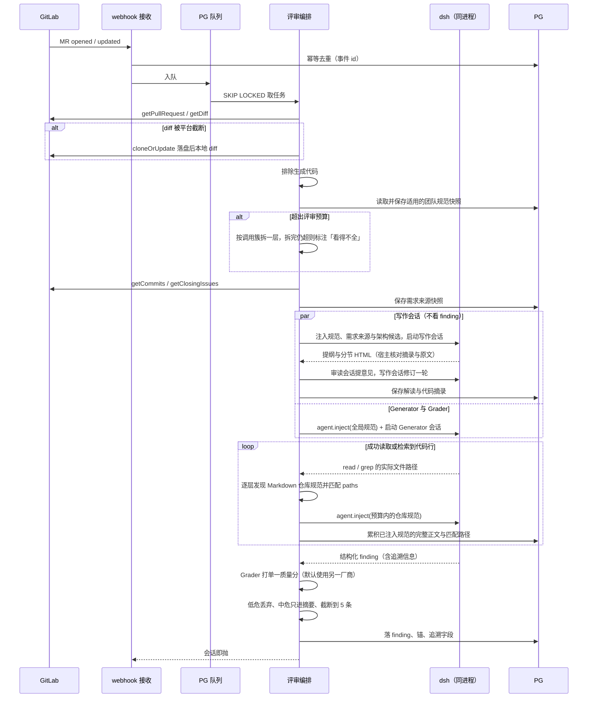
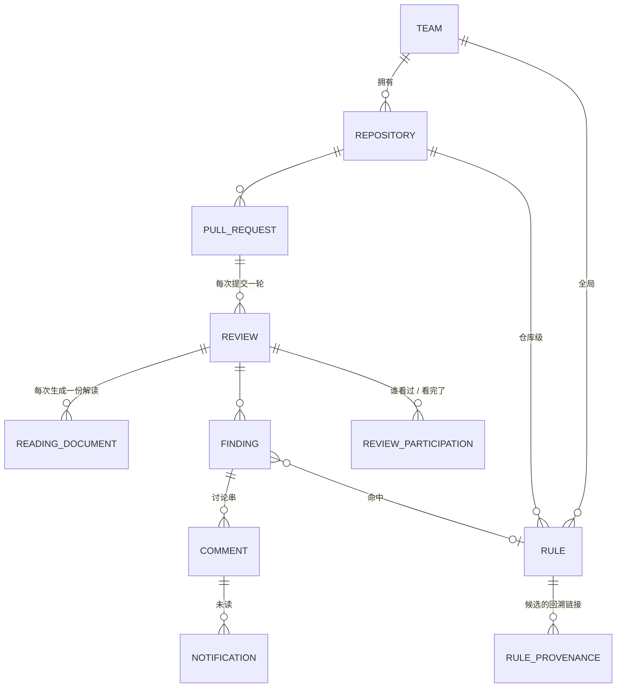

# 架构

uReview v1 的产品与架构。动 `packages/` 之前先读这里。测试策略与验收判据在 [testing.md](testing.md)，领域词汇在 [glossary.md](glossary.md)。

存量事实一律带 `source:` 指回出处——[Agent Note](../.agents/notes/README.md) 或 [调研](research/)。本次新做的决定不带锚点。

## Problem Statement

**评审人打开一个 PR，看不完。**

AI 大量参与写代码之后，单个 PR 的体量和变更密度都上去了。现有的路径是「左边文件树、右边 diff，从第一个文件第一行开始看」——那等于要求人先读完再判断。实际发生的是抽查：看几个眼熟的文件，剩下的靠信任。真正会出事的那几处，和缩进、命名、格式一起躺在三千行 diff 里。

**团队的标准不在任何地方。**

「金额必须用整数分」「对外接口必须幂等」这类约定，存在于几个老成员的脑子里、群聊记录里、以及三个月前某条 MR 评论里。新人不知道，所以犯；老人知道，所以要一遍遍指出来。没有人能回答「我们到底有多少条规范」，更没有人能回答「哪条规范其实已经没人遵守了」。

**现有的 AI review 工具评完就走。**

它们把评论贴在 PR 上，一次性、无状态。报了什么、有没有人改、为什么没改，事后无从查起——也就无法知道这工具到底有没有用。更关键的是，这一轮评审里人做的判断（「这条不是问题，因为我们这个模块本来就允许」）没有被任何东西接住，下一轮还会再报一遍。**评审产生的知识全部蒸发了。**

---

## Solution

**一个独立的评审工作台。评审在这里完成，不是在 PR 上留言。**（source: issues/25-开源定位-相对-pr-agent-与-openreview-的差异化.md）

PR 进来，系统产出一份有结构的评审：一份解读讲清楚这个 PR 改了什么、改动前后怎么工作、关键代码怎么读；一组 finding 按严重度排好，每条带描述、代码锚、证据链接和修复提示词。人从解读和结论栏往下读，只在需要时下钻到 diff。

人对每条 finding 做处置——采纳，或者驳回并留一句理由。处置被记下来，连同「读了哪些文件」「命中哪条规范」「哪个模型给了多少分」一起。于是三个数能被算出来：**多少 PR 是在这里被评审的**（北极星）、**finding 被采纳的比例**（护栏）、**多少 PR 没经评审就合并了**（约定执行情况）。（source: issues/02-成功指标与沉默优于噪声的判据.md）

规范可保存在工作台数据库中，也可从 Git 文件读取。管理员可生成并编辑数据库规则，设置分类、严重级别及团队全局或多仓库路径范围，保存草稿或启用。全局规范保存在数据库中，适用于当前团队全部仓库；Git 仓库规范随 agent 实际读取的路径匹配并注入。（source: [仓库规则注入](../.agents/notes/implemented/architecture/2026-10-04-repository-rule-injection.md)）规范表把每条的命中、采纳、被无视三列摆出来——**空转的和被无视的都会被看见**。系统扫描历史 PR 的人工评论，从有后续代码落实证据、且跨 PR 复现的建议中挖出最多十条候选，附回溯链接，交团队管理员审核采纳。（source: [候选资格与管理员审核](../.agents/notes/implemented/bug-fix/2026-10-06-mining-without-author-identity.md)）

**全程只读代码平台，一个写方法都没有。**（source: issues/26-代码平台抽象与首发平台.md）不回写评论，不推合并状态。代价是有人可以绕开我们直接合并——补法是让偏离可见，而不是造技术门禁。（source: issues/31-团队协作的含义与边界.md）

---

## User Stories

### A. 仓库接入与评审触发

> 场景：`features/repository-onboarding.feature`、`features/review-trigger.feature`

1. 作为管理员，我想把一个 GitLab 仓库接进来，以便这个仓库的 PR 能被评审。
2. 作为管理员，我想在接入时只提供一个只读令牌，以便这套工具能过公司的安全评审——一个只读令牌造不成任何破坏。（source: issues/31-团队协作的含义与边界.md）
3. 作为管理员，我想看到 webhook 的连通状态与最近一次事件时间，以便在列表空着的时候分得清是配置断了还是确实没有新 PR。
4. 作为管理员，我想单独开关某个仓库的评审，以便先在一个低风险仓库上试跑再铺开。
5. 作为评审人，我想 PR 一开就自动触发评审，以便我打开的时候结论已经在那里了。
6. 作为评审人，我想 PR 有新提交时自动重新评审，以便我看到的结论对应的是最新代码。
7. 作为评审人，我想手动重跑一次评审，以便在规范刚改过之后立刻看到新结论。
8. 作为评审人，我想在评审还在跑的时候看到「进行中」而不是一个空列表，以便不把「还没跑完」误读成「没有问题」。
9. 作为评审人，我想在评审失败时看到失败原因，以便知道该找管理员还是该继续等。

### B. 评审列表

> 场景：`features/review-list.feature`

10. 作为评审人，我想看到待评审 PR 的列表，含仓库、标题、作者、状态和按严重度分的 finding 计数，以便决定先看哪一个。
11. 作为评审人，我想按仓库和状态筛选，以便只看我负责的那部分。
12. 作为评审人，我想一眼看出哪些 PR **还没有任何人看过**，以便不和同事重复劳动，也不会两个人互相等。（source: issues/31-团队协作的含义与边界.md）
13. 作为评审人，我想看到这次评审我自己看没看完，以便中断之后能接着上次的位置。
14. 作为团队负责人，我想看到本月有多少 PR 未经评审就合并了，以便知道团队约定有没有在被执行——这个数不是用来罚人的。（source: issues/31-团队协作的含义与边界.md）

### C. 评审页——解读与评审入口

> 场景：`features/pr-summary.feature`、`features/pr-reading.feature`

> Story 24 起综述并入解读：15–18 由解读的概要、方案与行为变化和代码导读承担，19、20 不再生成，21 保留为 Generator 提交的文件分组，用在代码文件树。（source: [解读只讲实现](../.agents/notes/implemented/architecture/2026-10-07-reading-explains-implementation.md)）

> 这一组的字段集以三条真实 Qodo 评论为对照标准，对照的是**内容结构**而非 markdown 版式。（source: issues/33-v1-复现目标-qodo-的三件产出.md、assets/qodo-real-comments/）

15. 作为评审人，我想先读到一句话描述这个 PR 在做什么，以便在看任何代码之前就有个判断的锚。
16. 作为评审人，我想看到变更类型与预估评审时长的标签，以便安排什么时候看。
17. 作为评审人，我想看到三条要点，以便快速抓住这个 PR 最该被关注的地方。
18. 作为评审人，我想看到一张 mermaid 图描述改动涉及的流程，以便理解跨文件的改动是怎么串起来的。
19. 作为评审人，我想看到 AI 列出的替代实现方案，每个带正负号，以便判断作者选的这条路合不合理。
20. 作为评审人，我想看到一段推荐意见，以便知道 AI 整体上倾向于放行还是要求修改。
21. 作为评审人，我想看到文件清单**按语义分组**、每个文件配一句话主题，以便不必逐个点开文件名去猜它改了什么。
22. 作为评审人，我想看到 Bugs、规范违规、跨仓冲突、Skill 洞察四个计数，以便一眼知道这次评审的问题构成。
23. 作为评审人，我想看到 Context sources——注入了多少条规范、作用域是什么、启用了哪些 skill、评审档位以及定这个档位的理由，以便判断这次评审的结论有多少依据。
24. 作为作者，我想读到解读，以便确认 AI 理解的实现和我实际做的是一致的；不一致本身就是一个信号。

### D. finding

> 场景：`features/findings.feature`

25. 作为评审人，我想看到 finding 按严重度分组，以便先处理会出事的那些。
26. 作为评审人，我想每条 finding 都有描述、涉及的代码、**证据链接表**、以及一段可以直接喂给 coding agent 的修复提示词，以便判断它成不成立，成立的话直接动手。
27. 作为评审人，我想一个 PR 最多只被打断五次，以便这个工具不变成新的噪声源；超出的折叠起来并明说「还有 N 条已折叠」。（source: issues/02-成功指标与沉默优于噪声的判据.md）
28. 作为评审人，我想在需要时展开被折叠的 finding，以便在深度评审时能看全。
29. 作为评审人，我不想看到低危 finding，因为它们默认就该被丢掉。（source: issues/02-成功指标与沉默优于噪声的判据.md）
30. 作为评审人，我想在规范违规类的 finding 上看到它命中了哪条规范并能跳过去，以便确认这条规范是不是真的适用于这里。
31. 作为评审人，我想看到同一条规范在不同上下文里有不同的严重度（测试代码 vs 支付代码），以便不被一刀切的告警淹没。（source: issues/11-规范的领域模型与生命周期.md）
32. 作为评审人，我想知道这条 finding 的 grader 分数和用的哪个模型，以便在结论存疑时判断该信多少。

### E. diff 下钻

> 场景：`features/diff-anchoring.feature`、`features/review-workbench-e2e.feature`

33. 作为评审人，我想从评审页的 finding 一键下钻到它所在的代码位置，以便不用自己在文件树里找。（source: issues/32-前端组件选型与-diff-视图.md）
34. 作为评审人，我想在 diff 视图里看到 finding 锚在具体的行上，以便把结论和代码对上。
35. 作为评审人，我想看到完整的 diff 并带语法高亮，以便按平常读代码的习惯读。
36. 作为评审人，我想在 diff 视图里直接对 finding 做处置，以便不用来回跳。
37. 作为评审人，我想在 rebase 或 force-push 导致锚点失效时看到这条 finding 被标为「已过时」而不是锚到错误的行上，以便不被误导。（source: issues/11-规范的领域模型与生命周期.md）
38. 作为评审人，我想在 PR 大到平台给不出完整 diff 时仍然能看到完整变更，以便不因为 PR 大就看不成。（source: research/07-gitlab-集成能力边界.md）
39. 作为评审人，我想在 PR 超出评审预算被拆分时，看到系统明说「这块我们看得不全」，以便不把沉默当成没问题。（source: issues/12-大-pr-的递归拆分与动态规范选取.md）

### F. 处置

> 场景：`features/finding-disposition.feature`、`features/review-workbench-e2e.feature`

40. 作为评审人，我想采纳一条 finding，以便记录下「这个问题是真的、该改」。
41. 作为评审人，我想驳回一条 finding 并留一句理由，以便后来的人知道为什么这里被判为不是问题。
42. 作为评审人，我想看到每条处置是谁在什么时候做的、理由是什么，以便有分歧时能找到人聊。
43. 作为团队负责人，我想让「没有任何人处置就合并了」和「有人明确驳回了」在统计上分开，以便采纳率的分母是诚实的。（source: issues/11-规范的领域模型与生命周期.md）
44. 作为作者，我想看到评审人对每条 finding 的处置，以便知道哪些需要我改、哪些已经被判为不是问题。

### G. 讨论与通知

> 场景：见 [测试策略](testing.md#场景路径208-条场景)

45. 作为评审人，我想在一条 finding 下面开讨论串并能回复，以便争议就在争议发生的地方被记录下来。
46. 作为评审人，我想 @ 某个人，以便把该他看的东西推给他。
47. 作为作者，我想在有人 @ 我或者回复我的时候收到站内未读提示，以便讨论不会因为没人看见就死掉。（source: issues/32-前端组件选型与-diff-视图.md）
48. 作为管理员，我想配一个 webhook 出口把通知转到团队已有的 IM 里，以便不要求所有人天天来这里刷新。
49. 作为评审人，我想看到 GitLab 上已有的人工讨论（只读），以便在迁移期间能在一处看全，不至于因为这边少一半内容就弃用。（source: issues/32-前端组件选型与-diff-视图.md）
50. 作为评审人，我想在那些只读的历史讨论旁边看到「新讨论请在下方」的提示，以便不会顺手跑回 MR 里接着说。
51. 作为评审人，我想标记「这次评审我看完了」，以便同组的人知道这个 PR 已经被人看过了。（source: issues/31-团队协作的含义与边界.md）

### H. 规范

> 场景：见 [测试策略](testing.md#场景路径208-条场景)

52. 作为评审人，我想看到一张生效规范表，含正文、作用域、来源，以便知道团队到底有哪些约定。
53. 作为团队负责人，我想在规范表里看到每条的**命中、采纳、被无视**三列，以便发现哪些规范在空转、哪些在被无视。（source: issues/32-前端组件选型与-diff-视图.md）
54. 作为团队负责人，我想看到规范分全局和仓库两级、以及仓库继承了哪些全局规范，以便理解某条规范为什么会在这个仓库生效。
55. 作为团队负责人，我想在某条全局规范不适用于我这个仓库时，把它降到仓库级而不是给它加一个关闭开关——**层级本身就是开关**。（source: issues/11-规范的领域模型与生命周期.md）
56. 作为团队负责人，我想在刚接入时就看到系统从我们自己的历史 PR 里挖出的候选规范，以便第一天打开规范表看到的不是一张空表。（source: issues/10-规范冷启动-从零产出第一版团队规范.md）
57. 作为团队负责人，我想每条候选都带回溯链接——从哪几条历史评论挖出来的、跨了几个 PR、后续代码如何落实建议，以便核对依据并审核采纳。
58. 作为团队负责人，我想候选包含**后续代码落实证据**且**跨 PR 复现**的评论，以便从重复发生的改进中提炼规范。
59. 作为团队负责人，我想首轮候选不超过十条，以便规范库不会一上来就失控。
60. 作为团队负责人，我想把确认过的候选复制进仓库的规范文件并提交，之后它在我们这里显示为生效，以便版本化、评审、回滚全部白拿。（source: issues/10-规范冷启动-从零产出第一版团队规范.md）

### I. 度量与追溯

> 场景：见 [测试策略](testing.md#场景路径208-条场景)

61. 作为团队负责人，我想看到评审覆盖率——多少比例的 PR 是在这里被评审的，以便知道人愿不愿意来。
62. 作为团队负责人，我想看到采纳率，以便知道来了之后有没有用。
63. 作为产品负责人，我想每条 finding 自带追溯信息——读了哪些文件的哪些行、命中哪条规范、grader 给了多少分、用的哪个模型、谁在什么时候用什么理由处置的，以便事后能算出所有指标、也能回答「这个结论是怎么来的」。（source: issues/13-服务端技术栈与-dsh-的嵌入形态.md）

### J. 异常与降级

> 场景：`features/degradation.feature`

64. 作为评审人，我想在 LLM 不可用时看到一次明确失败的评审，以便不会把「没跑起来」当成「没有问题」。
65. 作为管理员，我想在代码平台不可达时看到明确的错误，以便去查凭据或网络而不是怀疑产品。
66. 作为管理员，我想 webhook 重复投递同一个事件时不会产生两份评审，以便列表不被重复项污染。

---

## Implementation Decisions

### 模块划分

| 模块 | 职责 |
|---|---|
| **平台端口** | 只读八方法，provider 声明能力、上层按能力降级 |
| **评审编排** | 取 diff、排除生成代码、规范硬过滤、（超预算时）拆分、驱动 dsh、收结构化产出 |
| **finding 存储与锚定** | 落库、rebase 后重定位、失效转 `Outdated` |
| **协作** | 处置、讨论串、评审参与状态、通知未读与 webhook 出口 |
| **规范** | 数据库规则生成与维护、Git 只读同步、候选挖掘、统计投影 |
| **Web 前端** | 概览、评审、仓库、团队规范、成员与团队、设置；评审内提供 diff 下钻与讨论 |

### 平台端口：只读八方法，零写方法

`onEvent` / `getPullRequest` / `getDiff` / `getFileContent` / `getGroupingSignals` / `cloneOrUpdate` / `getCommits` / `getClosingIssues`。提交列表与 MR 关闭的 issue 通过 GitLab GET 分页读取，标题、描述和提交信息保存为本轮需求来源快照。（source: [PR 解读阶段](../.agents/notes/implemented/architecture/2026-10-06-pr-design-reading.md)）

- **没有任何写方法。** 这是范围收窄最大的收获——GitLab 调研里「做不到的事」绝大部分是写侧的，现已全部不适用。（source: research/07-gitlab-集成能力边界.md）
- 统一数据结构沿用 `FilePatchInfo` 的思路，provider 只负责填充、上层永不碰平台差异。我们的结构比 PR-Agent 的更简单，**不承载任何发布用的定位信息**。
- **仍然成立的读侧硬约束**：大 MR 拿不到完整 diff（默认 200KB patch、1000 文件、50000 行），所以 `cloneOrUpdate` 兜底路径必须有。（source: research/07-gitlab-集成能力边界.md）
- **只读凭据要两个 scope**：API 读取用 `read_api`，`cloneOrUpdate` 走 Git-over-HTTP 要 `read_repository`。只给 `read_api` 时 clone 兜底不可用。（source: research/07-gitlab-集成能力边界.md §5.6）
- **webhook 当信号还是数据源、要不要定时对账。** 调研的建议是只当「有事发生了」的信号、回头调 API 拉当前状态，并定期扫描活跃 MR 对账，因为漏事件是常态。漏掉合并事件时 `Ignored` 判定与度量会错。**v1 不做对账**（第一版以快速验证为先），发现漏事件导致判定出错时再加，见 [DFX 七维](../requirements/01-v1-qodo-reproduction/issues/02-dfx-七维.md)。（source: research/07-gitlab-集成能力边界.md §9.9）
- 首发 GitLab，但用手头的真实 GitHub 数据同步校验端口，防止抽象长成「GitLab 的形状加一个假接口」。
- **GitLab 能力版本参考**，用于后续真实实例联调；当前按公开 API 协议实现，不增加版本探测或兼容矩阵。（source: research/07-gitlab-集成能力边界.md §0、[接入决定](../.agents/notes/implemented/architecture/2026-10-02-gitlab-repository-onboarding.md)）

  | 能力 | 最低版本 |
  |---|---|
  | webhook 去重键 `Idempotency-Key` | 17.4 |
  | diff 超限标志 `collapsed` / `too_large` | 18.4 |
  | Free 版 service account（此前要 Premium，低版本退化为 group access token） | 18.11 |
  | webhook `webhook-id` 与 HMAC 签名（之前只有明文 token 比对） | 19.0 |

### 仓库接入

接入使用独立只读适配器，评审平台端口包含八个只读方法。当前接受个人访问令牌（PAT，含服务账号 PAT），通过 self-inform 核对仅有 `read_api`、`read_repository`，再验证项目 API 与 Git 读取。仓库按实例地址与项目 ID 去重，重复接入保留原凭据和验证时间；凭据密文入库，密钥在独立持久卷文件中。行为与接口见 [Story 01 规格](../requirements/01-v1-qodo-reproduction/01-connect-gitlab-repository/spec.md)。（source: [接入决定](../.agents/notes/implemented/architecture/2026-10-02-gitlab-repository-onboarding.md)）

仓库详情按评审、规范、评审设置、接入与事件组织。自动评审默认开启，关闭只影响 webhook 自动触发；手动发起和重跑保持可用。每仓库保留最近 100 条鉴权成功的事件结果，鉴权失败只记最近时间。独立 `WebhookReader` 通过 GET 读取项目 hooks，展示配置匹配与权限不足状态；配置检测和实际事件送达分别展示。（source: [仓库详情与事件](../.agents/notes/implemented/feature/2026-10-06-repository-detail-and-webhooks.md)）

团队管理员可预览影响并输入完整仓库路径，永久删除仓库及关联数据；有进行中评审时拒绝，排队评审一并清除。工作台规范保留并移除该仓库的作用范围，事务提交后清理对应评审的工作副本目录。删除不调用代码平台。（source: [仓库永久删除](../.agents/notes/implemented/feature/2026-10-06-repository-deletion.md)）

### dsh 的嵌入：单进程，服务作为 dsh host 插件

（source: issues/13-服务端技术栈与-dsh-的嵌入形态.md、research/34-dsh-插件机制与单进程方案.md）

我们的服务作为 dsh 的 host 插件，和 agent 运行时跑在同一个 Node 进程里，dsh 以自定义 profile 启动。一个进程跑多个并发评审会话；沙箱按会话的 cwd 解析，不是进程级的。多用户、认证与 HTTP 面由我们自己的插件承担，不用 dsh 的单 operator 认证。v1 验证过这条链路（spike 在 alpha.2 上六项全过，见 [原型必要性](../requirements/01-v1-qodo-reproduction/issues/04-原型必要性.md)）。

两条铁律不是建议，是「跟着 dsh 上游走」这个约束能成立的前提：

1. **只碰 dsh 文档列出的公开扩展点**——`ctx.agents.create/resume`、`SessionPersistence`、agent preset、`ctx.tools` 与 agent 私有工具、`agent.inject()`、`session/event`、`ctx.webServer.register`。一行 patch 内部代码的事都不做。依据是实测的迭代速度：24 天 16 个版本、20 天改 10455 个文件、删 9 个包新增 49 个、没有 CHANGELOG。（source: research/03-deepseek-harness-能力边界.md）
2. **评审会话完成后释放。** finding、证据、引用和可回看的会话事件落进 PostgreSQL；文件会话日志和上传保持关闭。规范编写的恢复检查点与只读查看记录分别保存。

#### 会话持久化边界

规范对话保存于团队隔离的 PostgreSQL 表，包含对话记录、各轮结果、当前编辑稿和 dsh 恢复数据。运行时通过公开 `SessionPersistence` 接口收集完整日志，以 `ctx.agents.resume` 恢复前文及工具历史。每轮完成后释放内存 agent；用户重新打开页面或服务重启后可继续。（source: [规范持久会话](../.agents/notes/implemented/feature/2026-10-04-persistent-rule-conversations.md)）

规范编辑页读取用户要求、公开回复、草稿和生成状态，恢复日志属于服务端数据。通用会话查看器通过独立展示投影读取原始消息与工具过程。生成失败保留当前工作稿和上次成功的恢复点，失败轮次仍显示在对话中。用户手动修改的当前草稿随下一轮要求送入模型。

会话编辑稿与生效规范分别保存。管理员明确保存或启用时，在同一事务里写入规范并建立会话关联；以后保存更新同一条规范。版本检查保护并发编辑，旧评审快照保持原样。恢复格式随当前锁定的 dsh 版本验证，升级 dsh 时须验证旧恢复数据的兼容性。

#### 通用会话查看器

运行记录列表与评审、规范页面共用右侧查看器。团队管理员可从管理导航进入运行记录，成员保留业务入口及原有会话读取权限。独立 iframe 通过公开客户端接口挂载官方 dsh 对话、轨迹与工具展示；只读 HTTP 接口按当前团队权限提供有序历史和游标增量。每次运行的查看记录与原生会话 ID 分开，失败轮次独立保留，规范成功检查点负责恢复对话。启动时导入可验证的已有规范成功历史并标记遗留运行中断。（source: [会话查看决定](../.agents/notes/implemented/feature/2026-10-05-agent-session-viewer.md)）

#### 评审会话

一次评审的形状：

- **建会话**：`ctx.agents.create({ meta: { cwd, agentPreset }, agentOptions, setup })`。`agentOptions` 必须带当前模型选择，否则第一轮报 no provider/model。在 `setup` 里挂评审 preset、注册 agent 私有的上报工具、收窄工具。
- **规范由宿主经 `agent.inject()` 提供。** 全局规范在任务开始前注入；仓库规范通过公开的 `tools/post-execute` 扩展点，在成功 `read` 或 `grep` 返回代码行后按路径发现并注入。写作会话、Generator 与 Grader 各自记录送达状态；Grader 评分前按规范 finding 的主位置补齐适用规则，后续读取继续触发发现。（source: [仓库规则注入](../.agents/notes/implemented/architecture/2026-10-04-repository-rule-injection.md)）
- **finding 由上报工具交回**：工具参数用 JSON schema 约束，execute 校验代码证据与规范引用，通过后写 PG 并收进报告。参数或内容不合格时返回纠错信息，保持已接受报告不变；持久化等致命故障阻止整轮完成。（source: [报告提交协议](../.agents/notes/implemented/architecture/2026-10-05-review-report-protocol.md)）
- **判定跑完**：`agent.whenIdle()` 等本轮结束，再读最后一个 `turn/end` 的 reason。正常结束后还须验证报告完成、全部已接受 finding 的评分和追溯；最终数据库事务提交后评审才完成。（source: [报告提交协议](../.agents/notes/implemented/architecture/2026-10-05-review-report-protocol.md)）

报告收集模块统一管理已接受的文件分组、finding、评分、结束状态与致命故障。`finish_report` 先确认合法文件分组且没有致命故障，再封存 Generator 报告；缺项时返回纠错信息并保持开放。被拒绝的调用不产生 finding 或评分义务，显式完成的合法报告可以没有 finding。`AgentTrace` 负责模型身份、实际读取与公开完成事件，失败尝试作为会话记录保留。（source: [报告提交协议](../.agents/notes/implemented/architecture/2026-10-05-review-report-protocol.md)）

报告工具的接受与拒绝记录随本轮保存，评审页可展开拒绝次数与原因。模型成功率以会话身份关联评审最终状态计算，finding 提交拒绝率以接受与拒绝次数计算；统计展示由 Story 22 承接。（source: [提交记录与度量](../.agents/notes/implemented/feature/2026-10-06-keep-review-results.md)）写作会话、Generator、Grader 各有 128 次步骤预算，调查与纠错共用。读取证据随实际工具结果累积，checkpoint 压缩不会清空宿主账本。（source: [压缩与读取证据](../.agents/notes/implemented/bug-fix/2026-10-06-review-compaction-evidence.md)）

配套的硬约束：

- **代码检索必须挂真实 volume。** `grep` 和 `glob` spawn 的是打包进来的 ripgrep 二进制、走 `ctx.subprocess`，完全绕过 `ctx.fs`。（source: research/03-deepseek-harness-能力边界.md）
- **评审 agent 只给只读工具。** 挂 preset 不会收窄 host 全局层的工具（bash、write、edit、web_fetch、subagent 都在），要在 `setup` 里 `tools.restrict` 到 read、grep、glob 加上报工具。
- **profile 要显式关掉的行**：文件会话持久化；每次请求附带整段会话日志与插件包清单的上传；会话标题生成（每个会话多一次模型调用）。
- **插件自身**必须有带 version 的 `package.json`，否则插件包清单会让每次模型请求失败；消息 source 用自定义 kind，`{ kind: 'plugin' }` 会被会话格式 v4 拒绝。
- **自定义工具返回值自己管大小**——没有「工具声明我要分页」的位，工具自己在返回值里带 `truncated` 和 `total`。
- base profile 不带 WebServer；采用 dsh 的 WebServer 服务时需另加 `dsh-host-webserver` 行。uReview 的 host 插件直接启动 Fastify，同样处于 dsh 的 Node 进程内。

Story 02 的实现使用 PostgreSQL 队列与提交快照，Generator、Grader 分别运行独立 agent，保存结构化 finding、实际工具读取范围和各阶段的只读会话记录。两个模型默认来自不同厂商；读工具在执行前校验真实路径，限制在本次工作副本内。完成需满足报告结束、全部评分及公开完成事件，diff 未就绪则有限等待。具体范围和接口见 [Story 02 规格](../requirements/01-v1-qodo-reproduction/02-review-new-pull-request/spec.md)。（source: [运行时决定](../.agents/notes/implemented/architecture/2026-10-02-review-runtime-and-trace.md)、[同厂商配置](../.agents/notes/implemented/architecture/2026-10-04-same-vendor-model-opt-in.md)）

### 评审流水线

每轮读完需求来源后，写作会话与 Generator 同时开始，互不参考。写作会话使用 Generator 的模型配置，输入有 PR 元数据、diff、需求来源、架构候选文档和规范注入，没有本轮的 finding。解读只讲实现，不做判断；finding 覆盖规范违规与缺陷。两边各自成败，工作副本在两边都结束后清理；评审先于解读完成时，IM 通知等解读结束后再入队。每次生成单独保存在 `reading_documents`，评审完成后可以重新生成，PR 已有新提交时失败并说明原因。（source: [解读只讲实现](../.agents/notes/implemented/architecture/2026-10-07-reading-explains-implementation.md)）

写作会话通过 `submit_outline`、`write_section`、`finish_document` 分节提交受限 HTML 加 `ur-*` 组件。宿主核对 `ur-code` 引用的行本会话读过并截取至多 60 行摘录，核对 `ur-source` 的原文出自需求来源，在服务端解析 Mermaid；格式问题一次列全后拒绝，可修正的问题修正后在回执中说明。模型没结束就停下时最多提醒两次。第一稿完成后，审读会话用 Grader 的模型槽位、不带读代码的工具，按读者视角提意见，写作会话修订一轮。审读失败不影响第一稿。（source: [解读只讲实现](../.agents/notes/implemented/architecture/2026-10-07-reading-explains-implementation.md)）

架构候选来自根目录 `AGENTS.md`、`CLAUDE.md`、`README.md`、`ARCHITECTURE.md`，`docs/architecture*.md`，以及变更路径各级上级目录的 `AGENTS.md`。宿主只列出存在且位于可读范围内的路径，由模型读取。需求来源是本轮 PR 标题与描述、提交信息和关闭的 GitLab issue 快照，读取失败时保留已读到的部分，解读照常进行。外部工单系统未接入。（source: [PR 解读阶段](../.agents/notes/implemented/architecture/2026-10-06-pr-design-reading.md)）

管理员可在仓库页面维护各仓库的排除目录，成员可查看，新接入的仓库默认为空。路径相对仓库根目录并包含全部子目录。每轮先按目标仓库的配置过滤 diff，再选择规范和启动模型；临时工作副本同步裁剪排除目录及 Git 元数据，保证两个模型的读取、搜索和仓库规则发现使用同一范围。评审保存当轮配置与排除数量。全部变更被排除时明确显示未调用模型；配置修改只影响后续执行的评审。（source: [评审排除目录](../.agents/notes/implemented/feature/2026-10-04-review-excluded-directories.md)、[仓库级配置](../.agents/notes/implemented/feature/2026-10-06-repository-review-exclusions.md)）



**拆分：只做一层，不递归。**（source: issues/12-大-pr-的递归拆分与动态规范选取.md）原型实测同一份数据上的直接对比：按文件切拆散 7/7 条关联，按调用簇切 0/7，**自动递归到底又回到 7/7**——每深一层就重新拆散一次。拆完仍装不下的，**标出来告诉人「这块我们看得不全」**，比硬切下去假装看全了诚实。PR-Agent 那个「按 token 数降序、大文件优先」的贪心装箱明确不抄。

**一条零成本的前置：先排除生成代码。** 原型里一个 pb 文件就占了整个 MR 的一多半。

**跨文件关联不单独建模。** 真实 Qodo finding 的 Evidence 列了六个文件，而 Qodo 没有任何「关联评审单元」机制——它就是让 agent 多读了几个文件。v1 不造这个机制，给 agent 足够的调查预算就行。（source: assets/qodo-real-comments/03-inline-finding.md）

**Grader 判一个分，不判多维。**（source: issues/15-grader-与阈值策略.md）只回答「这条值不值得打断人」，分数用于排序与过滤。理由之一是我们的标注口径是二值的（「你会不会动手改」），**用二值标注去校准多维评分器校不准**。

**Generator 与 Grader 默认使用不同厂商的模型。** LLM 对熟悉的输出存在评分偏好。（source: research/24-防护过度与-ai-生成代码的缺陷模式.md）部署者可用 `UREVIEW_ALLOW_SAME_VENDOR=true` 显式接受同厂商组合；两阶段仍使用独立 provider route，追溯如实保存厂商和模型。开关随模型配置传入启动校验与评审运行时，默认关闭。（source: [同厂商配置](../.agents/notes/implemented/architecture/2026-10-04-same-vendor-model-opt-in.md)）

**v1 不做的两样**：去重算法（在「最多五条」的前提下几乎不需要）、阈值按四维分（那是有数据之后的调参）。

### 数据模型



**规范来源**：工作台数据库和 Git 文件。数据库规则生成与属性语义见 [数据库规则决定](../.agents/notes/implemented/feature/2026-10-04-database-rule-authoring.md)。

全局规范从 PostgreSQL 读取当前团队已启用的数据库规则，不依赖规范仓库或部署变量。未启用全局规范时可以正常评审；数据库读取失败明确终止评审。（source: [数据库全局规范](../.agents/notes/implemented/architecture/2026-10-05-database-global-rules.md)）

仓库规范读取 PR 工作副本中各层 `.agents/rules/**/*.md`，frontmatter 的 `paths` 相对所在层目录匹配实际读取路径，坏文件告警跳过。仓库规则的稳定 ID 为 `repository:<仓根相对文件路径>`；同名规则不会互相覆盖。（source: [仓库规则注入](../.agents/notes/implemented/architecture/2026-10-04-repository-rule-injection.md)）

数据库规则由管理员设置草稿或启用。启用规则在评审开始时按当前团队、目标仓库及变更路径筛选；规则名称、正文、正反例、分类、严重级别和版本存入本轮快照。全局范围只覆盖当前团队，仓库范围可分别配置路径模式。

规范经 `agent.inject()` 提供，完整正文、来源版本和累积匹配路径随评审保存。只有已经注入的规则可被 finding 引用；预算不足而只展示索引的条目不进入规范快照。文件格式、预算与失败边界见 [Story 03 规格](../requirements/01-v1-qodo-reproduction/03-review-with-repository-rules/spec.md)；规范目录和周期同步由 [Story 11](../requirements/01-v1-qodo-reproduction/11-rule-catalog-and-mining/spec.md) 独立承接，旧评审快照保持不变。（source: [快照决定](../.agents/notes/implemented/architecture/2026-10-02-git-rule-snapshots.md)）

规范按原则、通用、语言、团队四层分组，层级独立于作用域。路径与语言在同一文件上匹配，显式覆盖逐文件排除上层规范。原则只指导判断，不能被 finding 命中。团队全局规范可对指定仓库记录有理由的豁免及撤销；评审快照保留生效路径、覆盖关系与当轮豁免依据。（source: [规范层级与效力](../.agents/notes/implemented/feature/2026-10-06-rule-hierarchy-and-effect.md)）

判断题属性标识启发式规范，进入当轮规范快照。三个评审阶段要求以「可能的 X」说明依据与例外，并服从团队规范；报告入口拒绝命中判断题的高危 finding，返回中危重试说明。规范库应用与更新保留属性，finding 标签读取历史快照。（source: [判断题规范](../.agents/notes/implemented/feature/2026-10-06-judgement-rules.md)）

数据库规范保存于独立表，Git 目录同步不改写这些记录。生成使用已配置的 Generator，通过无文件工具的 dsh 会话提交结构化草稿；保存和启用是管理员显式操作。编辑携带版本以检测并发冲突。草稿不参与评审，停用不改变旧快照。

仓库 lint 配置来自各层 `.agents/lints/` 的直属 `.mjs` 文件，静态解析 `export const meta` 后与 Git 规则一起同步，单独展示名称、路径、脚本与来源提交。只读评审不执行 lint，lint 不进入规范快照和命中统计。发现与失败边界见 [仓库 lint 目录](../.agents/notes/implemented/feature/2026-10-04-repository-lint-catalog.md)。

规范页按层级排列已启用规范，以来源作为筛选条件，提案统一承接工作台草稿、历史挖掘与驳回反馈。Git 历史候选由人复制进规范文件，目录同步按同仓正文相同识别生效。详情与目录共享已完成评审的展示 finding 统计，采纳和驳回读取当前处置；目录缺失的 Git 规范可查看历史评审快照。（source: [规范库、详情与提案](../.agents/notes/implemented/feature/2026-10-06-rule-library-details-and-proposals.md)）

管理员应用规范库条目直接创建已启用的团队全局规范，并保留条目及版本关联。整套与部分条目可重复应用，已有规范原样保留，只创建缺失项。页面展示已应用标记、创建与跳过数量，不提供规范库更新入口。（source: [规范库直接应用](../.agents/notes/implemented/simplification/2026-10-08-direct-library-application.md)）

服务管理员可上传 Markdown 或文本规范文件。系统确定性切片，Generator 按大纲规划规范集并逐片提交条目；实例同一时刻执行一个导入，每个导入最多并行生成四个片段。管理员预览后调整规范集属性、删除条目并发布，发布结果与内置规范集共同组成规范库。导入数据属于实例，应用沿用团队事务创建独立规范；删除发布来源保留已应用内容。（source: [企业规范导入](../.agents/notes/implemented/feature/2026-10-09-enterprise-rule-library-import.md)）

管理员可确认删除工作台规范，删除携带版本并保留评审快照、会话和审核历史；关联的待审核提案撤回。已删除规范有历史快照时，详情提供只读快照。删除后可重新应用规范库条目；被拒绝的规范库草稿显示未应用，重新应用创建生效规范并保留拒绝记录。（source: [删除工作台规范](../.agents/notes/implemented/feature/2026-10-08-managed-rule-deletion.md)）

团队管理员可在提案列表批量采纳或填写统一理由后批量拒绝，选择仅覆盖当前可见的待审核项。审核逐条保存并显示结果，需修改工作台规范的反馈保留逐条编辑入口。（source: [提案批量审核](../.agents/notes/implemented/feature/2026-10-06-proposal-batch-review.md)）

**finding**：

```
finding
  规范 id      如果是规范违规
  标题 / 描述 / 证据链接 / 修复提示词
  严重度       数据库规则违规按规则配置，Git 规则和普通缺陷按上下文
  锚           文件 + 行号 + 代码内容指纹
  状态         Pending / Resolved / Dismissed / Ignored / Outdated
```

成员可采纳（`Resolved`）、驳回（`Dismissed`）或撤回已有处置。驳回包含理由类别，其他类需补充说明；撤回后回到初始状态 `Pending`。团队共用当前处置，版本检查保护并发修改，变更历史与操作人一起保存。使本轮全部展示 finding 都有处置的操作，为该操作者记录看完。规范目录按当前 `Resolved` 计算采纳；`Ignored` 的合并后判定尚未交付，被无视计数保持 0。（source: [处置与多轮对比](../.agents/notes/implemented/feature/2026-10-06-finding-dispositions-and-round-comparison.md)）

高中危 finding 保存代码片段指纹，包含折叠项。详情比较同一 PR 上一个已完成轮次，返回新出现、上一轮也有及本轮未再出现列表。上一轮处置只作参考，本轮状态独立。（source: [处置与多轮对比](../.agents/notes/implemented/feature/2026-10-06-finding-dispositions-and-round-comparison.md)）

### 五条本次对谈补定的规则

规格初稿在这五处留了空白，写场景时被审出来，已由需求方拍板（这四条是本次新做的决定，不带来源锚点）：

| | 决定 |
|---|---|
| **中危 finding 的口径** | **中危是独立 finding**，与高危一样挂在代码上（source: [finding 挂在代码上](../.agents/notes/implemented/feature/2026-10-08-findings-inline-in-diff.md)）；**「每个 PR 最多 5 条」的额度中高危一起数**。这样打断总量才真的封顶 |
| **评审档位** | **三档，按变更行数**：快速（< 200 行）、标准（200–1000 行）、深度（> 1000 行）。定档理由写命中的阈值 |
| **评审列表的状态** | **四态：待评审 / 进行中 / 已完成 / 失败**，描述的是「评审」这个对象本身。**PR 已否合并是 PR 自己的属性，另列一列**，不和评审状态混在一个字段里 |
| **webhook 连通异常的判定** | **超过 24 小时没收到事件即标「可能异常」**（阈值可配），并提供手动连通探测。这是为了让管理员分得清「配置断了」和「确实没有新 PR」——没有它，一个两周没 PR 的仓库和一个 webhook 断了的仓库在界面上长得一模一样 |
| **超大 PR 的 diff 展示** | **沿用 Generator 提交的文件语义分组，默认全部折叠、按需展开**，不做分页。分页会把人推回「从第一个文件开始看」的模型，与「评审页为主、diff 是下钻」的立场冲突 |

**埋点字段必须随第一版 schema 落地，不能后补**——已经跑过的评审补不回来。（source: issues/02-成功指标与沉默优于噪声的判据.md）

### 锚定

**文件 + 行号 + 代码内容指纹。** 不回写平台之后，这个结构不必迁就任何平台格式——不照抄 GitLab 的六元组。指纹用于 rebase 或 force-push 之后重定位，定不回去就转 `Outdated`。渲染时才临时算出 diff 组件要的 `extendData`，这样换组件不动领域模型。（source: issues/11-规范的领域模型与生命周期.md）

### 部署与多租户

（source: issues/13-服务端技术栈与-dsh-的嵌入形态.md）

- 全 TypeScript；一条 `docker compose up`，允许多容器。
- **PostgreSQL 单库承载一切，含队列**（`SKIP LOCKED`），不引入 Redis。
- **一套部署服务一家公司。** 租户等于这套部署，团队是数据模型里的概念；共享 schema 加 `team_id` 加行级安全策略，不做 schema 隔离更不做库隔离。
- **行级安全策略的连接角色前提**（2026-09-18 拍板，工单 01 评审时发现）：不做管理/应用双角色，将来建表时用 `FORCE ROW LEVEL SECURITY` 让表的 owner 也受策略约束。**但 `FORCE` 管得住 owner，管不住超级用户**——超级用户无条件绕过 RLS。Compose 的应用角色为 `ureview_app`，迁移与查询共用该非超级用户、无 BYPASSRLS 的 owner。初始化脚本创建角色，已有卷升级时转交现存表的所有权；启动会校验角色。业务表强制 RLS，认证目录按真实会话查询。（source: [团队隔离](../.agents/notes/implemented/architecture/2026-10-04-team-identity-and-rls.md)）
- 代码工作副本挂真实 volume；对象存储起步本地卷，留 S3 兼容口子。
- **v1.0 之前不保证 schema 迁移，v1.0 起承诺**：`docker compose pull` 加重启，数据不丢。

团队管理员从我的待办的引导清单确认接入进度；实例健康由服务管理员在实例管理中查看。健康汇总沿用强制 RLS 下的逐团队读取，具体评审仍遵守团队成员权限。安装、升级、备份与恢复见 [运维说明](operations.md)。（source: [引导与实例健康](../.agents/notes/implemented/feature/2026-10-06-onboarding-and-instance-health.md)）

### 角色与权限

（source: issues/31-团队协作的含义与边界.md）

两种角色：**成员**（看、讨论、处置 finding、提规范候选）、**管理员**（接仓库、改配置）。

数据库规范的生成、编辑和启用由当前团队管理员负责，普通成员可阅读。Git 规范继续通过仓库自身的提交权限和评审流程维护。

**明确不做的四条线**：不做站内聊天；通知只做未读加 webhook 出口、不做通知中心；不做工单与日程；**不重做平台已有的 reviewer 指派与 approve**——重做一遍的唯一效果是让人在两个地方各看一半。

**合并门禁靠组织约定，不做技术强制。** 曾考虑推 commit status 做软门禁，否掉的理由是运维后果：做门禁意味着进入合并的关键路径，uReview 挂了 PR 就卡住，**那是年轻产品承受不起的承诺**。替代手段是用可见性代替强制力——列表里标出「还没人看过」，统计里记「本月多少 PR 未经评审就合并」。

### 前端

评审页以规则结论和默认解读为入口，代码与问题、依据与追溯分别置于标签内。服务端详情返回按展示 finding 推导的结论与处置计数；阅读引用下钻到平台 diff，返回保留标签、位置和焦点。解读在浏览器端导出带内联样式与图示的离线 HTML。（source: [解读与代码工作台](../.agents/notes/implemented/feature/2026-10-06-review-reading-workbench.md)）

代码与问题中，高危与中危 finding 的卡片挂在所指代码之后，右栏是问题目录，文件树标出问题数。证据保存评审时读取的代码并在页内定位；只有没有保存证据代码、且位置不在差异片段内的旧轮次才给平台链接。早于中危挂锚保存的中危在读取详情时补锚。（source: [finding 挂在代码上](../.agents/notes/implemented/feature/2026-10-08-findings-inline-in-diff.md)）

（source: [工作台页面组织](../.agents/notes/implemented/feature/2026-10-04-light-workspace-navigation.md)）

| | 选择 | 关键理由 |
|---|---|---|
| 页面与组件 | **React + Vite、语义 HTML 与原生 dialog** | 复用现有实现，统一侧栏、表单、表格和详情面板 |
| 表格 | **HTML table + 独立滚动容器** | PR 使用服务端分页；完整仓库、规范和成员列表支持本地搜索，规范统计支持排序 |
| diff | **`@git-diff-view/react`** | Monaco 与 CodeMirror 出局的理由比「能不能挂 widget」更早：它们吃两份完整文档**自己重算 diff**，而我们的数据来自平台 patch，重算结果可能不一致、**finding 会锚错** |

**样式边界**：不引入 dsh 的 `ui-theme`（全局规则会影响滚动条和圆角）；使用 Tailwind 时关闭 preflight。diff 组件按 `packages/web/package.json` 固定版本安装，渲染平台 patch；流程图采用 Mermaid 的严格安全配置。（source: [内容与展示决定](../.agents/notes/implemented/architecture/2026-10-03-review-content-and-presentation.md)）

**门户结构**参考 Qodo 的固定侧栏、页内标签页、工具条、表格和详情面板。侧栏按工作台、代码与规范、管理分组，管理入口按权限展示。头像菜单进入我的账号，团队设置与实例管理分别承载团队和服务配置；页头弹窗发起评审。首页提供按 GitLab 身份匹配的个人待办与讨论提醒；团队管理员在团队概览查看最近四周统计及团队总计。（source: [身份与待办](../.agents/notes/implemented/architecture/2026-10-06-personal-inbox-identities.md)）旧设置链接按权限重定向，其余 query 深链接保持兼容。（source: [导航与设置](../.agents/notes/implemented/feature/2026-10-06-navigation-and-settings.md)）

**设计系统**使用雾白页面底、白色表面、灰绿色边界和青绿色强调。状态保留文字与柔和颜色，代码与 diff 使用常规增删着色和语法高亮。窄屏导航可展开，表格在独立容器中滚动。

**一条产品立场**：评审页为主、diff 是下钻。不是布局偏好，是「不以行内评论为主」这条立场的延续——「左文件树右 diff」那种模型等于把人又推回从第一个文件第一行开始看。

### 多语言

**v1 没有语言特定的代码**，新增一门语言的成本约等于在扩展名映射表里加一行。（source: issues/28-多语言支持策略.md）diff 解析、finding 锚定、agent 调查都与语言无关；语法高亮由 diff 组件自带的 `highlight.js` 覆盖约 190 种；规范全是文本、由 LLM 读。唯一沾语言的是超预算时按调用簇切分，用文本检索做即可。

**这条的重开触发条件是引入可执行规范**（semgrep、lint）——那时每门语言要单独实现，而各语言差距是结构性的（ruff 完全不支持自定义规则、CodeQL 许可禁止在私有仓库上做自动化）。而可执行规范正是被明确砍掉的东西。

---

## Out of Scope

**明确不做的（决策已落，不重争）：**

- **回写代码平台**——不发评论、不发 PR 说明、不推 commit status。端口零写方法。
- **重做平台已有的 reviewer 指派与 approve**、站内聊天、通知中心、工单与日程。
- **可执行规范与静态检查**（semgrep、lint、CodeQL）。v1 规范全是文本、由 LLM 读。
- **规范的编辑与确认流程**——v1 规范表只读，挖掘产候选、人复制进 git 提交。（source: issues/31-团队协作的含义与边界.md）
- **去重算法**、**阈值按 assistant/语言/类别/消费者四维分**。
- **移动端。**

**押后到有基线之后（不是想错了，是没基线判断不了值不值）：**（source: issues/33-v1-复现目标-qodo-的三件产出.md）

- 评审高度：分层交互与自顶向下的下降路径；高层观察对象化。
- **跨仓库评审**的 L2 与 L3 能力；需求级评审。
- 完整评审配置、统计页和跨 PR 的 finding 列表。成员、团队权限及通知出口设置由团队能力扩展实现。
- dsh `main` 的整页席位逃生舱（留口子，v1 不用）。

**暂不处理的技术项：**

- C 语言的内存问题（明确划出范围）。

---

## Further Notes

**一条贯穿全局的原则**，来自规范冷启动那场讨论，但适用范围比它大：

> **任何需要前置建设的资产，产品都要能在它缺席时降级运行，并在使用中反过来把它喂大。**

规范是这样（零规范时通用 bug review 与解读本来就有价值，挖掘让「规范在长」从第一天就可见）；统一代码视图是这样；跨仓能力也是这样。新增功能时用这把尺子量一下。

**两处被真实数据推翻过的早期结论**，记下来防止重犯：

1. 「跨单元关联必须单独建模成一类评审单元」——**真实 Qodo finding 的 Evidence 列了六个文件，而它没有任何关联机制**，就是让 agent 多读了几个文件。原结论的前提是「跨仓库、没有统一代码视图」，单仓库内不成立。
2. 「本仓库关闭全局规范」需要一个开关——**换成「把它降到仓库级」，层级本身就是开关。**

**一条过程教训**（source: issues/11-规范的领域模型与生命周期.md）：规范模型的初版给了四态状态机、可执行与判断型两类对象、仓库级关闭三个细节。需求方的反馈是「我都看不懂，说明不是我现在关心的需求功能」。**那是对的——在给还不存在的规模设计治理机制。十条规范不需要状态机。** 这份规格里凡是看着像治理机制的地方，都该先问一遍「现在的规模需要它吗」。

**规划从这里接续**：v1 的轮廓与迭代计划在 [requirements/01-v1-qodo-reproduction/](../requirements/01-v1-qodo-reproduction/map.md)。

## 团队能力实现

Story 09 提供用户名账号、服务器初始化码、不透明会话与团队成员角色。用户名必填、全实例唯一且不区分大小写，邮箱为可选联系资料。已有账号以原邮箱前缀迁为用户名，密码和会话保留。（source: [用户名登录](../.agents/notes/implemented/feature/2026-10-06-username-login.md)）HTTP 与后台任务共享按团队借出的连接池；连接归还前清除团队上下文。已有记录归入默认团队。（source: [身份与 RLS](../.agents/notes/implemented/architecture/2026-10-04-team-identity-and-rls.md)）

Story 10 将评论、回复、提及、个人未读与评审参与记录保存在工作台。通知出口使用 PostgreSQL 队列，GitLab 讨论来自独立只读历史适配器，评审平台端口包含八个只读方法。（source: [协作规格](../requirements/01-v1-qodo-reproduction/10-review-collaboration/spec.md)）

Story 11 从 Git 默认分支建立完整规范目录，统计读取真实 finding 状态。候选提取要求至少两个 PR 重复和评论后的精确代码替换证据；提交者身份不影响候选资格，候选进入提案，由团队管理员审核采纳。候选复制进 Git 后按同仓库正文相同识别生效。（source: [规范目录与候选](../.agents/notes/implemented/architecture/2026-10-04-rule-catalog-and-evidence-mining.md)、[候选资格与管理员审核](../.agents/notes/implemented/bug-fix/2026-10-06-mining-without-author-identity.md)、[统一提案](../.agents/notes/implemented/feature/2026-10-06-rule-library-details-and-proposals.md)）

Story 26 支持实例级 OIDC 或 OAuth2 企业登录，回调在服务端完成，沿用不透明会话与 Strict Cookie。绑定按身份源命名空间和用户标识唯一，默认按用户名关联，服务管理员不参与自动关联；新账号无密码，以成员身份加入默认团队。密码登录可限制为仅服务管理员，并保留至少一名有密码的管理员作为恢复入口。（source: [企业登录认证与账号边界](../.agents/notes/implemented/feature/2026-10-09-enterprise-sso-login.md)）

### 服务配置权限

服务管理员是独立于团队角色的实例权限，在设置页管理 Generator、Grader 的模型名称、Base URL、API key 与服务管理员授权。密钥加密保存在 PostgreSQL，数据库值优先于环境变量，通过公开 dsh CredentialProvider 接缝在每次请求解析。模型名称及接口地址支持页面配置，协议与厂商由部署指定。（source: [实例服务权限与模型密钥](../.agents/notes/implemented/feature/2026-10-05-service-model-credentials.md)）

配置页默认用掩码显示已保存密钥，点击显示才读取明文。验证按钮通过独立的公开 dsh Context 和正式模型适配器测试当前表单连接，保留已保存配置；每次只发送固定的简短提示，不创建业务会话。接口使用实例服务权限、版本校验和不缓存响应，返回安全的结果分类。（source: [密钥显隐与验证](../.agents/notes/implemented/feature/2026-10-05-model-key-verification.md)）
