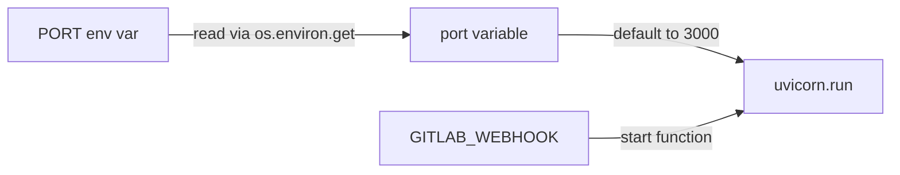
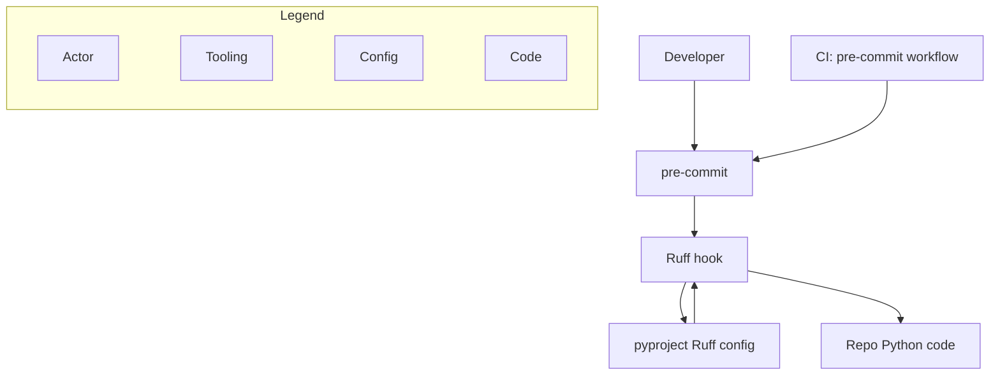

# Qodo 产品形态调研（面向原型重建）

- **调研时间**：2026-09-12
- **调研目的**：为企业内部 AI code review 平台（自托管 GitLab / 10 团队 / 100 研发 / 每周 100+ MR / C 与 Go 为主）绘制原型，Qodo 为最接近的商业参照物。
- **文档性质**：规格说明，不是产品测评。目标是"照这个能把界面重建出来"。

## 来源清单

一手来源（本次实际抓取）：

| 编号 | 来源 | 获取方式 | 说明 |
| --- | --- | --- | --- |
| S1 | `qodo-ai/pr-agent` 仓库 | `git clone --depth 1`，HEAD = `1421c673` (2026-09-10) | 开源版 PR-Agent 源码。**版式的最权威来源**：渲染器代码直接决定 markdown 输出 |
| S2 | `pr_agent/algo/utils.py` | 源码 | `/review` 的 markdown 渲染器 `convert_to_markdown_v2()`，含全部 emoji 映射与表格结构 |
| S3 | `pr_agent/tools/pr_description.py` | 源码 | `/describe` 的渲染器，含 File Walkthrough 表格生成逻辑 |
| S4 | `pr_agent/tools/pr_code_suggestions.py` | 源码 | `/improve` 的渲染器 `generate_summarized_suggestions()`，含分组、评分、折叠结构 |
| S5 | `pr_agent/settings/*.toml` | 源码 | 提示词模板（定义输出字段 schema）与 `configuration.toml`（全部默认值） |
| S6 | `docs.qodo.ai` 全站 | `curl` 抓取 raw markdown（URL 加 `.md` 后缀返回 MDX 源码） | 商业版文档。共下载 44 个页面 + `llms-full.txt`（908KB / 218 页全文） |
| S7 | `docs.qodo.ai/code-review/comment-anatomy` | 同上 | **商业版评论版式的官方规格页**，逐区块描述 |
| S8 | `docs.qodo.ai/.../portal-configuration` | 同上 | Web 控制台 Configurations 页的**完整设置项清单**（6 个 Tab，每项含默认值） |
| S9 | `docs.qodo.ai/governance/*` | 同上 | 规则系统、Rule Miner、Findings 页、Repositories 页、Analytics |
| S10 | 真实 PR 评论 | `gh api` 抓取 GitHub 公开 PR 的评论 body | 见第 1.7 节 |
| S11 | `qodo.ai` 营销站 | WebFetch | **营销话术，已单独标注** |

> 说明：本次 WebSearch 配额已耗尽，未使用搜索引擎；所有内容来自上述直接抓取。

---

## 0. 先厘清：两个产品，两套版式

这是整份调研最容易踩的坑。**Qodo 当前有两套完全不同的 PR 评论版式**，不能混着抄：

| | **开源版 PR-Agent** | **商业版 Qodo Merge / Qodo Code Review** |
| --- | --- | --- |
| 仓库/站点 | `qodo-ai/pr-agent`（历史：`Codium-ai/pr-agent`） | `app.qodo.ai` + `docs.qodo.ai` |
| 命令 | `/describe` `/review` `/improve` `/ask` | `/agentic_describe` `/agentic_review` `/ask` `/fix` `/config` `/checks` `/generate_labels` |
| 评论组织方式 | **按工具分**：每个命令一条独立评论，各自一个大 `<table>` | **按 finding 分**：一条 summary 评论 + 若干 inline 评论，findings 按严重度分组 |
| 核心单位 | "suggestion"（建议）与 "key issue"（要点） | "**finding**"（发现），有 type / category / severity / state 四维属性 |
| 优先级表达 | `Suggestion importance[1-10]` → High/Medium/Low | severity：High / Medium / Low（词汇可配） |
| 配置方式 | `.pr_agent.toml` | Web 门户 Configurations 页（推荐）+ `.pr_agent.toml`（兜底） |
| Web 控制台 | 无 | 有，见第 4 节 |
| 规则 | `best_practices.md` 等仓库文件 | 中心化 Rules 表 + Rule Miner 挖掘 |

**对你的项目的意义**：开源版版式**可以直接抄、且有源码为证**（本文第 1–3 节给出精确骨架）；商业版版式只有文档描述和截图，但它代表了 Qodo 演进后的形态，信息架构更适合"100 人 / 每周 100+ MR"的规模（第 1.6 节）。建议原型：**用商业版的信息架构（findings + severity 分组 + 状态跟踪），用开源版的 markdown 实现手法（`<table>` + `<details>`）**。

### 命令对照（商业版，来源 S6）

| 命令 | 用途 | 说明 |
| --- | --- | --- |
| `/agentic_review` | 主审查流程 | 生成带优先级的 findings 与建议修复。可带 `--review_agent.issues_user_guidelines` 等参数 |
| `/agentic_describe` | PR 摘要 | 生成结构化 PR 摘要 |
| `/ask` | 提问 | 回答关于该 PR 与代码变更的问题 |
| `/config` | 查看配置 | 显示支持的配置键与默认值 |
| `/generate_labels` | 打标签 | 基于代码变更建议 PR 标签 |
| `/checks` | CI 排障 | 分析 CI 失败并给出调试上下文 |
| `/fix` | 修复 | Remediation agent 修复 finding（需开启） |

---

## 1. PR 评论的实际版式

### 1.1 `/review` — 开源版（骨架来源：S2 源码逐行还原）

**评论标题行**：`## PR Reviewer Guide 🔍`
（由 `format_pr_review_header()` 生成：`"## " + heading + " 🔍"`，heading 默认 `PR Reviewer Guide`，可用 `pr_reviewer.review_heading` 改写）

**身份标记**：紧随标题后插入一行 HTML 注释 `<!-- pr-agent:review:full -->`（增量审查为 `<!-- pr-agent:review:incremental -->`）。这是**持久化评论的锚点**——下次运行时靠它找到旧评论并原地更新，而不是重新发一条。

> 这是一个值得直接抄的工程做法：用不可见 HTML 注释做评论身份标识，避免了"每次 push 刷屏"。源码里还有 `comment_matches_identity()` 只在评论前 5 行内精确匹配该标记。

**整体结构**：**一个单列 `<table>`，每个信息块是一个 `<tr><td>`**。不是多列表格——单列 table 纯粹是为了在 GitHub 上获得带边框的卡片视觉。

```markdown
## PR Reviewer Guide 🔍

<!-- pr-agent:review:full -->

Here are some key observations to aid the review process:

<table>
<tr><td>⏱️&nbsp;<strong>Estimated effort to review</strong>: 3 🔵🔵🔵⚪⚪</td></tr>
<tr><td>🧪&nbsp;<strong>No relevant tests</strong></td></tr>
<tr><td>🔒&nbsp;<strong>No security concerns identified</strong></td></tr>
<tr><td>⚡&nbsp;<strong>Recommended focus areas for review</strong><br><br>

<details><summary><a href='https://github.com/o/r/pull/1/files#diff-abcL12-R14'><strong>Possible Issue</strong></a>

问题描述正文，说明它为什么是问题、什么场景会触发。此处不写行号。
</summary>

```go
func Foo(ctx context.Context) error {
    ...
}
```

</details>

</td></tr>
</table>
```

**各行（`<tr>`）的完整清单与 emoji 映射**（源码 `emojis` 字典，S2）：

| 字段 key | 显示名 | emoji | 默认开关 | 渲染形态 |
| --- | --- | --- | --- | --- |
| `estimated_effort_to_review_[1-5]` | Estimated effort to review | ⏱️ | 开 | `3 🔵🔵🔵⚪⚪`（蓝球数=分值，白球补足 5） |
| `relevant_tests` | — | 🧪 | 开 | 二值文案：`No relevant tests` / `PR contains tests` |
| `security_concerns` | Security concerns | 🔒 | 开 | 无问题时渲染为 `No security concerns identified`；有问题时正文首行加粗为小标题 |
| `key_issues_to_review` | **Recommended focus areas for review** | ⚡ | 开 | 折叠块列表，见下 |
| `risk_level` | Risk level | ⚠️ | **关**（opt-in） | `Low` / `Medium` / `High` |
| `merge_recommendation` | Merge recommendation | ✅ | **关** | `Safe to merge` / `Merge with caution` / `Changes required` |
| `review_priority_files` | Priority files | 📂 | **关** | `<ul><li>` 文件列表，空时显示 `None` |
| `score` | Score | 🏅 | **关** | 0–100 |
| `can_be_split` | Can be split | 🔀 | **关** | 建议拆成的子 PR 列表 |
| `todo_sections` | TODO sections | 📝 | **关** | 扫描出的 TODO 注释；无则 `✅ No TODO sections` |
| `ticket_compliance_check` | Ticket compliance check | 🎫 | 开（有关联 ticket 时） | 需求符合度：fully / not compliant / 需人工确认 |
| `contribution_time_cost_estimate` | Contribution time estimate | ⏳ | **关** | `best \| average \| worst` 三档工时 |
| `insights_from_user_answers` | — | 📝 | 条件 | — |

**关键细节**：

1. **`key_issues_to_review` 的每条 issue 是一个 `<details>`**，`<summary>` 里是 `<a href=行链接><strong>issue_header</strong></a>` 加一个空行再加 `issue_content`——**即摘要行里就带正文**，折叠起来的只有代码片段。展开后是带语言标注的代码块（` ```go `），代码从原文件按 `start_line`–`end_line` 截取并做 `textwrap.dedent()` 去缩进。
2. **条数上限**：`num_max_findings = 3`（默认）。这是个很克制的数字。
3. **`issue_header` 会被改写**：模型若输出 `Possible Bug`，渲染器强制改成 `Possible Issue`——源码注释写着 *"Make the header less frightening"*。这是刻意的语气设计。
4. **提示词明确禁止在 `issue_content` 里写行号**（行号通过链接体现）。
5. 非 GFM provider（不支持 HTML 表格时）降级为 `### {emoji} {标题}` 的纯 markdown 分节。

**审查提示词里的判据**（S5，值得抄的产品决策）：

- 对明确的 bug 和安全问题要彻底，不因触发场景窄就跳过；
- 对低严重度问题要**有把握才报**——"如果你无法用一个具体场景说清它为什么是问题，就不要报"；
- 不要仅凭猜测说某处会破坏其它代码，除非能从 diff 上下文指出具体路径；
- 不报风格偏好和有意的设计选择；
- 置信度低但影响大（数据丢失、安全）时可以报，但**必须显式写明哪部分不确定**；
- 语气要求：不用 "Great job"、"Thanks for" 之类的填充语。

### 1.2 `/describe` — 开源版

`/describe` **改写 PR 描述本体**（不是发评论），默认 `publish_description_as_comment=false`。

**生成结构**（源码 `_prepare_pr_answer()`，S3）——各区块之间用 `\n\n___\n\n`（水平线）分隔：

```markdown
### **PR Type**
Enhancement, Tests

___

### **Description**

- 用 1-4 个要点概括变更，每点不超过 8 个词

- 大 PR 可以给每个要点加子要点

___

### Diagram Walkthrough


___

<details> <summary><h3> File Walkthrough</h3></summary>

<table>
<thead><tr><th></th><th align="left">Relevant files</th></tr></thead>
<tbody>
<tr><td><strong>Enhancement</strong></td>
<td><details><summary>3 files</summary><table>
<tr>
  <td>
    <details>
      <summary><strong>server.go</strong><dd><code>新增连接池复用逻辑</code>&nbsp; &nbsp; </dd></summary>
<hr>

internal/net/server.go

变更的详细说明，每 61 字符插入一个 &lt;br&gt;

</details>
  </td>
  <td><a href="链接">+48/-12</a>&nbsp; &nbsp; </td>
</tr>
</table></td></tr>
</tbody></table>

</details>
```

**必须注意的结构细节**：

| 要点 | 说明 |
| --- | --- |
| 标题层级 | 顶层区块用 `### **PR Type**` 这种 **H3 + 加粗** 的写法（`key.replace("_"," ").capitalize()`，其中 `type` 特判成 `PR Type`） |
| `PR Type` 取值枚举 | `Bug fix` / `Tests` / `Enhancement` / `Documentation` / `Other`（源码 `PRType` 枚举，S5）。可用 `custom_labels` 自定义 |
| 分隔符 | 区块之间是 `___`（三下划线，渲染为 `<hr>`），不是 `---` |
| File Walkthrough 表头 | **只有两列**：一个空表头 + `Relevant files`。第三列（`+X/-Y` 行数）**没有表头**，是裸 `<td>` |
| 行分组 | 按**语义标签**分组（`bug fix` / `tests` / `enhancement` / `documentation` / `error handling` / `configuration changes` / `dependencies` / `formatting` / `miscellaneous` …），每组一个 `<tr>`，首列是 `<td rowspan>` 效果的组名（实际用 `<strong>{标签}</strong>`） |
| 折叠阈值 | `collapsible_file_list='adaptive'` + `collapsible_file_list_threshold=6`：**文件数 > 6 时**该组折叠成 `<details><summary>N files</summary>`。这个阈值对"每周 100+ MR"的场景很关键 |
| 文件名显示 | 只显示 **basename**（`filename.split("/")[-1]`）加粗，完整路径放在展开区内 |
| `<dd>` 用法 | 文件名下方用 `<dd><code>一行摘要</code></dd>` 显示 5–10 词的变更主题 |
| 空白填充 | 源码里大量 `&nbsp; ` 重复填充（`delta=75`）来撑开列宽——这是在 GitHub 表格里**伪造列宽**的 hack |
| 换行处理 | `insert_br_after_x_chars(text, x=61)` 每 61 字符插 `<br>`，因为 HTML 表格里不会自动折行 |
| 用户原描述保留 | `add_original_user_description=true`：**"PR Type" 字段以上的内容视为用户内容予以保留**，以下视为上次生成的内容并替换。这是它的幂等更新策略 |
| Mermaid 图 | `enable_pr_diagram=true` 默认开。方向 `adaptive`：链长 > 5 个节点时转为 `TD`，否则 `LR` |

**Markers 模式**（`use_description_markers=true`）：用户在 PR 描述里写 `pr_agent:type`、`pr_agent:summary`、`pr_agent:walkthrough` 占位符，工具只替换占位符位置。**这是给"想自己控制描述模板"的团队准备的**，对内部平台很实用。

### 1.3 `/improve` — 开源版

**标题**：`## PR Code Suggestions ✨`，身份标记 `<!-- pr-agent:improve:summary -->`。

**整体结构**：**一个三列 `<table>`**（这是与 `/review` 的单列表格最大的不同）。

```markdown
## PR Code Suggestions ✨

<!-- pr-agent:improve:summary -->

Explore these optional code suggestions:

<table>
<thead><tr>
  <td><strong>Category</strong></td>
  <td align=left><strong>Suggestion&nbsp; &nbsp; …（重复 66 次撑宽）</strong></td>
  <td align=center><strong>Impact</strong></td>
</tr>
<tbody>
<tr><td rowspan=2>Possible issue</td>
<td>

<details><summary>Guard against nil connection pool</summary>

___

**在解引用前检查 pool 是否为 nil，否则并发关闭时会 panic。**

[internal/net/server.go [142-148]](https://github.com/o/r/pull/1/files#diff-abcR142-R148)

```diff
-conn := p.pool.Get()
+if p.pool == nil {
+    return nil, ErrPoolClosed
+}
+conn := p.pool.Get()
```

<details><summary>Suggestion importance[1-10]: 9</summary>

__

Why: 并发关闭路径下 pool 确实可能为 nil，会导致 panic，属于真实缺陷。

</details>

</details>

</td><td align=center>High

</td></tr>
<tr><td>

…第二条建议，结构同上…

</td><td align=center>Medium

</td></tr>
</tbody></table>
```

**呈现规则逐条拆解**（源码 `generate_summarized_suggestions()`，S4）：

| 问题 | 答案 |
| --- | --- |
| **一次给几条？** | `num_code_suggestions_per_chunk = 3`（每个 diff chunk 3 条），`max_number_of_calls = 3`，并行调用。实际总数取决于 PR 大小。可用 `max_suggestions_per_file` 限制单文件条数（0=不限） |
| **怎么排序？** | 两级排序：①**按标签分组**，组的顺序 = 组内最高分降序；②**组内按分值降序** |
| **合成一条还是分开发？** | **默认合成一张大表**，一条评论。可用 `commitable_code_suggestions=true` 改为逐条 inline 可提交评论。还有 `dual_publishing_score_threshold`（≥ 某分值的建议**同时**出现在表格和 inline） |
| **每条带什么字段？** | `relevant_file`、`relevant_lines_start/end`、`existing_code`、`improved_code`、`suggestion_content`（建议正文）、`one_sentence_summary`（≤6 词摘要）、`label`、`score`、`score_why` |
| **代码怎么呈现？** | **`diff` 代码块**，不是 `suggestion` 块。用 `difflib.unified_diff(n=999)` 生成，砍掉前 5 行头部，得到纯 `-`/`+` 行 |
| **影响级别？** | 第三列 `Impact`。`new_score_mechanism=true`（默认）时把 1–10 分映射成词：**≥9 = High，≥7 = Medium，<7 = Low**。关掉则直接显示数字 |
| **为什么？** | 嵌套的第二层 `<details>`：`<summary>Suggestion importance[1-10]: 9</summary>` 展开后是 `__` + `Why: …` |
| **一键应用？** | 表格模式**没有**。`commitable_code_suggestions=true` 时用 GitHub 原生 ` ```suggestion ` 块，可点 "Commit suggestion" |
| **分数门槛** | `suggestions_score_threshold=0`（不过滤）。文档建议不要设到 8 以上，否则会砍掉高相关建议 |

**标签（Category 列）取值**，取决于 `focus_only_on_problems`（默认 `true`）：

- `focus_only_on_problems=true`（默认）：`security` / `critical bug` / `general`
- `focus_only_on_problems=false`：`security` / `possible bug` / `possible issue` / `performance` / `enhancement` / `best practice` / `maintainability` / `typo`
- 命中 `best_practices.md` 的建议额外打上 `Organization best practice` 标签

**嵌套折叠是它最显著的版式特征**：表格单元格里套 `<details>`（建议本体），建议本体里再套 `<details>`（评分理由）。两层折叠 + 表格，在 GitHub 上能把 10+ 条建议压缩到一屏。

**inline 可提交建议的格式**（源码 `pr_code_suggestions.py:1104`）：

```markdown
**Suggestion:** 在解引用前检查 pool 是否为 nil [possible bug, importance: 9]
```suggestion
if p.pool == nil {
    return nil, ErrPoolClosed
}
conn := p.pool.Get()
```
```

若无法生成可提交的替换范围，降级为：

```markdown
**Suggestion:** …… [label, importance: N]

Proposed code (not offered as a committable change because the proposed code was truncated):
```
……
```
```

**持久化与历史**：`persistent_comment=true`（默认），`max_history_len=4`。旧建议被折叠进 `#### Previous suggestions` 区，形如 `<details><summary>✅ Possible issue up to commit abc1234</summary>`，✅ 表示已被采纳。

**自查复选框**（`demand_code_suggestions_self_review=true`，默认关）：在评论底部加一个 checkbox，文案 `**Author self-review**: I have reviewed the PR code suggestions, and addressed the relevant ones.`。勾选后可自动折叠建议（`fold_suggestions_on_self_review=true`）甚至自动 approve（`approve_pr_on_self_review`）。**这个机制对"推动作者真正读建议"很有参考价值**。

### 1.4 `/ask` — 开源版

最简单的版式（源码 `pr_questions.py:170`）：

```markdown
### **Ask** ❓
用户提出的原问题文本

### **Answer:**
模型回答正文
```

细节：回答会做净化处理——**任何以 `/` 开头的行前面加一个空格**，防止在 GitLab 上误触发 quick action。这是个真实踩过的坑，值得抄。

`use_conversation_history=true`（默认）会带上对话历史。`/ask_line` 是行级提问，配 `resolve_threads` 可在模型判断问题已解决时自动 resolve 线程（注意：**也会 resolve 人类发起的线程**）。

### 1.5 其它 emoji / 文案约定（开源版）

- 触发命令的评论会被加上 reaction：`reaction_on_start = "eyes"`（👀）。成功/失败 reaction 默认为空。GitHub 只接受 `+1 / -1 / laugh / confused / heart / hooray / rocket / eyes`。
- 工具用法帮助折叠区：`<details> <summary><strong>✨ Describe tool usage guide:</strong></summary>` / `💡 Tool usage guide:`。
- "需要帮助"页脚：`<details><summary>Need help?</summary>- Type <code>/help how to ...</code> in the comments …`

### 1.6 商业版 Qodo 的 finding 版式（来源 S7：comment-anatomy 官方规格页）

商业版把评论重组成**三段递进**：PR 摘要 → findings 总览 → 单条 finding 展开。

#### (a) Pull request summary（一条评论）

四个区块：

1. **AI-generated description** — 默认作为**独立评论**发布，不改动原 PR 描述（可配置为合并进描述）。
2. **Tags and time estimate** — 标签取值：`Bug fix` / `Tests` / `Enhancement` / `Documentation` / `Configuration changes`；时间估计形如 `10-20 Minutes`，可发布为 Git 原生 label。
3. **Walkthroughs** — 三个子块：**Description**（白话说明改了什么、为什么）、**Diagram**（架构流向图）、**High-Level Assessment**（给作者和审查者的建议与替代方案）。
4. **File changes overview** — 每个文件三个信息：文件路径、变更类型（如 Bug Fix / Enhancement）、增删行数。

#### (b) Code review findings overview

- **Counts by category**（顶部计数 chip）：

  | 类别 | 含义 |
  | --- | --- |
  | 🐞 **Bugs** | 可能导致错误行为或失败的问题 |
  | 📘 **Rule violations** | 违反组织或仓库规则 |
  | 📎 **Requirement gaps** | 缺失或未满足的业务/工单需求 |
  | 🔗 **Cross-repo conflicts**（Beta） | 跨仓库边界检测到的破坏性变更 |
  | 📜 **Skill insights**（Beta） | 由仓库 skills 触发的指引或违规 |

- **Context sources**（可关）：列出本次审查用到的 rules / skills / 跨仓上下文 / web 检索来源，并带一行**路由摘要**，形如 *"2 issues published inline · 3 in summary"*。
- **Quality impact labels**（每条 finding 一个）：`Correctness` / `Security` / `Reliability` / `Performance` / `Observability`（Findings 页还有 `Architecture` / `Testability` / `Quality` / `Accessibility` / `Maintainability`）。
- **Severity 分组**：默认 `High` / `Medium` / `Low`，**词汇可切换**为 `Critical/Warning/Informational`、`Required/Recommended/Optional`、`P0/P1/P2`。
- **Resolved findings**：推新 commit 后已解决的 finding **保留在列表里并加删除线**，不消失。

#### (c) 单条 finding 展开后的 6 个 Tab

| Tab | 内容 | 默认展开状态 |
| --- | --- | --- |
| **Description** | 问题与潜在影响的白话说明 | Expanded |
| **Code references** | 问题所在代码片段 + 指向 PR 行的直链 | Collapsed |
| **Relevance**（Beta） | 历史相关 PR 中的类似 finding。⭐⭐⭐ High=历史上通常被采纳修复；⭐⭐ Medium=历史不一致；⭐ Low=历史上通常被忽略 | Collapsed |
| **Evidence** | 为什么被标记：具体命中的规则、关联的需求/工单 | Collapsed |
| **Agent prompt** | **可复制的提示词**，粘到任意 AI 编码工具里带完整上下文修复 | Collapsed |
| **Committable suggestion** | GitHub/GitLab 上附带可提交的修复，按钮：**Apply Suggestion** / **Add suggestion to batch** | — |

> **Relevance 这个设计值得重点关注**：它用历史 PR 里"同类 finding 最终被接受还是被忽略"来给当前 finding 打相关性星级。对你"降低误报噪音"的诉求，这是一个比调阈值更聪明的思路——但它依赖 PR 历史索引（见第 4 节 Repositories 页的 PR history indexing）。

#### (d) Previous reviews（原 Audit trail）

评论里一个可折叠区，位于 tip 与页脚之间：

- 一行 **Review updated until commit**，链接到当前审查对应的 commit；
- 每个更早的 commit 一个可折叠条目 **Results up to commit ...**；
- 带审查模式徽章，如 🚀 Fast、⚖️ Balanced；
- 展开显示那一轮的全部 findings，已解决的**加删除线并带 resolved 标记**。

#### (e) 原生 PR 标签

除评论外，可把两类信号发布为 Git provider 原生 label：**Review time estimate**（如 "10-20 Minutes"）和 **Blast radius**（如 "Large blast radius"）。

#### (f) Blast radius（原生标签）

Qodo 对每个 PR 给出一个风险分级，**依据是变更在代码库中的影响范围与敏感度，而不是 diff 大小**（官方举例：改一行生产数据库配置比改一大篇文档风险高）。三档：

- 🔴 **Large blast radius**
- 🟠 **Medium blast radius**
- 🟡 **Small blast radius**

标签取整个审查周期中出现过的**最高**风险等级；后续 commit 抬高风险时标签会更新，但一个 PR 同时只显示一个分级。默认关闭（`publish_blast_radius_labels = false`）。

> 对"每周 100+ MR"的场景，这个标签的价值在于**让人在 MR 列表页就能分流**，不用点进去才知道该不该仔细看。建议原型里做，且和"审查投入估计"标签并列。

### 1.7 官方推荐的低噪音配置配方（直接可抄）

文档 `reduce-review-noise` 给出了一套面向"finding 量大"团队的推荐配置，这基本就是为你的场景写的：

1. **Overflow > Findings visible per group**：High = **All**，Medium = **1**，Low = **1**。
2. 打开 **Advanced comment routing overrides**，路由矩阵设为：

   | Severity | Destination |
   | --- | --- |
   | High | **Both**（inline + summary） |
   | Medium | **Summary**（只进摘要） |
   | Low | **Drop**（直接丢弃） |

3. 关闭 **Show images and animations**。
4. 用 **Finding content sections** 折叠/隐藏不需要每次都看的部分。
5. **Comment parts** 里关闭 **Show context**、**Show tip of the day**、**Show previous reviews**、**Show comment footer**、**Divider lines**。

最终效果：High 级 inline + 摘要都出现；Medium 级只在摘要里；Low 级完全不显示；评论只剩 findings 本身。

> **这套配方本身就说明了一个产品判断**：Qodo 承认默认配置对高频团队太吵，并且把"丢弃 Low 级"作为官方推荐而非羞于承认的降级。你的原型可以更进一步——**把这套低噪音配置直接做成默认值**，而不是让用户自己去发现。

### 1.8 真实 PR 评论原文（逐字抄录）

以下全部来自 GitHub 公开仓库 `The-PR-Agent/pr-agent`（即原 `qodo-ai/pr-agent`）真实 PR 上机器人留下的评论，通过 `gh api` 取 `body` 原文，未做改写。机器人账号：`qodo-free-for-open-source-projects[bot]`（开源免费版，跑的是商业引擎）与 `qodo-code-review[bot]`。

> **一个重要的工程约束**：抓到的商业版审查评论正文达 **65157 字节**，已经贴着 **GitHub 单条评论 65536 字符上限**，末尾出现了截断和一段异常重复的规则名。**商业版这套版式在 finding 多 + 历史轮次多时会撞上平台上限**。原型设计时必须把"历史轮次折叠内容"做成可裁剪的，或改为外链。

#### 原文 1：开源版 `/review` —— `## PR Reviewer Guide`

来源：<https://github.com/The-PR-Agent/pr-agent/pull/2201#issuecomment-3939769552>（2026-02-22）

~~~~markdown
## PR Reviewer Guide 🔍

#### (Review updated until commit https://github.com/qodo-ai/pr-agent/commit/f8ff082b6b6a3e30fb859fcc8d74f5127e051b8e)


Here are some key observations to aid the review process:

<table>
<tr><td>

**🎫 Ticket compliance analysis 🔶**


**[1964](https://github.com/qodo-ai/pr-agent/issues/1964) - Partially compliant**

Compliant requirements:

- Send utilization/usage signals via OpenTelemetry (tracing + metrics).
- Support exporting via OTLP (and console exporter).
- Provide configuration knobs for enabling/disabling and exporter selection.

Non-compliant requirements:

-

Requires further human verification:

- Validate end-to-end that traces/metrics are emitted and correctly attributed in a real backend (e.g., Datadog) for both `console` and `otlp` exporters.
- Confirm operational defaults (export intervals, batching) are acceptable for production workloads.


</td></tr>
<tr><td>⏱️&nbsp;<strong>Estimated effort to review</strong>: 4 🔵🔵🔵🔵⚪</td></tr>
<tr><td>🧪&nbsp;<strong>No relevant tests</strong></td></tr>
<tr><td>✅&nbsp;<strong>No TODO sections</strong></td></tr>
<tr><td>🔒&nbsp;<strong>Security concerns</strong><br><br>

<strong>Sensitive information exposure:</strong><br> The new telemetry attributes can include `pr_agent.pr_url` when `OTEL.INCLUDE_PR_URL` is enabled (see usage in `pr_agent/agent/pr_agent.py`). PR URLs may contain private repo/org identifiers and could be exported to third-party observability systems via OTLP. Ensure documentation clearly warns about this and consider further redaction/hashing options (e.g., repo name only, or a one-way hash) to minimize data leakage. Also note that `OTEL.OTLP_HEADERS` may contain API keys/tokens; while this PR avoids logging headers, ensure no downstream logs/exception paths can inadvertently emit these values.</td></tr>
<tr><td>⚡&nbsp;<strong>Recommended focus areas for review</strong><br><br>

<details><summary><a href='https://github.com/qodo-ai/pr-agent/pull/2201/files#diff-db2b038f914c88e292869242ae3c293765511994a83d72459642e81b5b741f47R57-R170'><strong>Telemetry overhead</strong></a>

The code unconditionally creates spans and records metrics for each request/command; even when telemetry is disabled it still executes span creation and metric calls (no-op providers typically minimize cost, but there is still call overhead). Consider guarding span creation and counter increments behind `OTEL.IS_ENABLED` (or a cached config boolean) to reduce runtime overhead in the default disabled mode.
</summary>

```python
    with get_tracer().start_as_current_span("pr_agent.handle_request") as span:
        # Set base attributes
        if get_settings().get("OTEL.INCLUDE_PR_URL", False):
            span.set_attribute("pr_agent.pr_url", pr_url)
        ...
```

</details>

<details><summary><a href='https://github.com/qodo-ai/pr-agent/pull/2201/files#diff-154411ec79fe41f9059940cb1267679e0281484dfe7786d92157125057d99944R19-R41'><strong>Shutdown handling</strong></a>

Metrics provider shutdown is registered via `atexit` inside `_init_metrics`, while tracing shutdown is handled in a separate module. This split can lead to double-shutdown or inconsistent flushing behavior depending on initialization order. Consider centralizing shutdown registration (single place) and ensure both tracer and meter providers flush reliably.
</summary>

```python
def _init_metrics():
    try:
        if not get_otel_config().is_enabled:
            return metrics.get_meter(__name__)  # no-op
        ...
```

</details>

<details><summary><a href='https://github.com/qodo-ai/pr-agent/pull/2201/files#diff-4d7c51b1efe9043e44439a949dfd92e5827321b34082903477fd04876edb7552R12-R12'><strong>Dependency risk</strong></a>

Changing `google-cloud-aiplatform` from a pinned version to a lower-bounded range can introduce unexpected breaking changes via transitive upgrades and make builds non-reproducible. Consider pinning to a known-good version (or using a constrained range) consistent with the project’s dependency strategy.
</summary>

```text
google-cloud-aiplatform>=1.66.0
google-generativeai==0.8.3
```

</details>

</td></tr>
</table>
~~~~

> 三处代码块内我用 `...` 做了省略（原文是完整的长代码），其余逐字保留。三条 finding 的结构完全同构，可直接作为行模板。

**从这条真实评论读出的、源码里看不到的细节**：

1. 标题下方紧跟一行 `#### (Review updated until commit <完整 commit URL>)` —— 这是 `final_update_message=true` 的产物，**用 H4 且整行套在圆括号里**。
2. **Ticket compliance 行排在最前面**，在 effort 之前。它不带 `<td>` 内联样式，而是在 `<td>` 里另起空行写 markdown：`**🎫 Ticket compliance analysis 🔶**`，🔶 表示"部分符合"。然后是 `**[1964](issue链接) - Partially compliant**`，下面三个固定小节：`Compliant requirements:` / `Non-compliant requirements:` / `Requires further human verification:`。**空的小节会留一个孤零零的 `-`**（见 Non-compliant 那节）——这是个可以改进的小瑕疵。
3. 安全问题非空时的渲染确认为：`🔒&nbsp;<strong>Security concerns</strong><br><br>` 换两行后，正文首个短语被加粗成小标题 `<strong>Sensitive information exposure:</strong><br>`。
4. 三条 finding 的 `issue_header` 都是**两个词**：`Telemetry overhead`、`Shutdown handling`、`Dependency risk`。
5. 代码块语言标注会跟随文件类型，非代码文件用 ` ```text `。

#### 原文 2：开源版 `/improve` —— `## PR Code Suggestions ✨`

来源：<https://github.com/The-PR-Agent/pr-agent/pull/2167#issuecomment-3754986058>（2026-01-15）

~~~~markdown
## PR Code Suggestions ✨

<!-- a44ac71 -->

Explore these optional code suggestions:

<table><thead><tr><td><strong>Category</strong></td><td align=left><strong>Suggestion&nbsp; &nbsp; &nbsp; &nbsp; &nbsp;（此处共 66 个 &nbsp; 用于撑宽列） </strong></td><td align=center><strong>Impact</strong></td></tr><tbody><tr><td rowspan=1>High-level</td>
<td>


<details><summary>Integrate existing static analysis tools</summary>

___

**Instead of creating custom static analyzers using regular expressions, integrate <br>with mature, existing open-source tools like Semgrep, ESLint, or Ruff. The agent <br>should execute these tools and process their standardized output.**


### Examples:


<details>
<summary>
<a href="https://github.com/qodo-ai/pr-agent/pull/2167/files#diff-bcf7d9465d7c363aa3d9ab2edc536a2fb052a141fd17d5bc1b5a1e12673645ccR61-R102">pr_agent/tools/security_analyzer.py [61-102]</a>
</summary>


```python
class SecurityAnalyzer:
    """
    Analyzer for security vulnerabilities in code.

    Detects:
    - Hardcoded secrets and credentials
    - Sensitive data in logs
    - Unsafe deserialization
    - Path traversal vulnerabilities
    - XSS patterns

 ... (clipped 32 lines)
```
</details>


<details>
<summary>
<a href="https://github.com/qodo-ai/pr-agent/pull/2167/files#diff-3aacc6c2ee44fc9a61e98046a14c8344d39d840bfc49f2ffeab5c85c6f9ccbbcR58-R94">pr_agent/tools/sql_analyzer.py [58-94]</a>
</summary>


```python
class SQLAnalyzer:
    ...
 ... (clipped 27 lines)
```
</details>


### Solution Walkthrough:


#### Before:
```python
class WorkizPRReviewer:
    async def run(self):
        # ...
        await self._run_language_analyzers()
        await self._run_custom_rules()
```


#### After:
```python
class WorkizPRReviewer:
    async def run(self):
        # ...
        await self._run_static_analysis_tools()

    async def _run_static_analysis_tools(self):
        # 1. Checkout PR code to a temporary directory
        temp_dir = self.git_provider.checkout_pr_code()

        # 2. Run established, mature static analysis tools
        semgrep_output = self._run_external_tool("semgrep --json .", temp_dir)
```


<details><summary>Suggestion importance[1-10]: 10</summary>

__

Why: This suggestion addresses a critical architectural flaw; building custom, regex-based static analyzers is fragile and unsustainable, and this PR implements several of them, making this a high-impact recommendation.


</details></details></td><td align=center>High

</td></tr><tr><td rowspan=5>Possible issue</td>
<td>


<details><summary>Ensure last function is analyzed</summary>

___

**Add a final check after the loop in <code>_check_function_complexity</code> to ensure the <br>complexity of the last function in a file is correctly analyzed.**

[pr_agent/tools/language_analyzers/python_analyzer.py [78-133]](https://github.com/qodo-ai/pr-agent/pull/2167/files#diff-7611fbb78a4547851fb7c2296009d2daf741d195f7926775efe9ff7392ddefc1R78-R133)

```diff
 def _check_function_complexity(self, content: str, file_path: str, lines: list[str]) -> None:
     """Check for overly complex functions."""
     func_pattern = re.compile(r'^\s*(?:async\s+)?def\s+(\w+)\s*\(([^)]*)\)')

     in_function = False
     func_start = 0
-    ...
+    func_name = ""
+    func_indent = 0
+
     for i, line in enumerate(lines, start=1):
         match = func_pattern.match(line)
         if match:
             if in_function:
                 func_length = i - func_start
                 ...
```

</details></td><td align=center>Medium

</td></tr>
</tbody></table>
~~~~

**这条真实评论暴露了源码里读不出来的两件事**：

1. **存在一个特殊的 `High-level` 分类**，排在所有分类最前面，且它的内部结构**与普通建议完全不同**——不是 `diff` 块，而是：
   - 加粗的建议正文（每 84 字符插 `<br>`）
   - `### Examples:` 小节：若干个 `<details>`，每个 summary 是 `<a href=行链接>文件路径 [起-止]</a>`，展开是**被截断的现有代码**，截断处写 ` ... (clipped 32 lines)`
   - `### Solution Walkthrough:` 小节：`#### Before:` 与 `#### After:` 两个代码块
   - 这是给"架构级建议"准备的版式，因为架构问题无法表达成一个行内 diff。**如果你的平台要给 C/Go 项目提架构建议，这个版式值得直接抄。**
2. 身份标记这一版用的是 **commit 短 sha** `<!-- a44ac71 -->`（较新版本才改成 `<!-- pr-agent:improve:summary -->`）。
3. 普通建议的行链接格式确认为 `[文件路径 [起-止]](行链接)`，**方括号套方括号**。

#### 原文 3：开源版 `/describe` —— 被改写后的 PR 正文

来源：<https://github.com/The-PR-Agent/pr-agent/pull/2157>（PR body）

~~~~markdown
### **User description**
## Summary
- Allow overriding the GitLab webhook server port via PORT env var
- Add unit test for PORT override

## Testing
- python3 -m pytest tests/unittest/test_gitlab_webhook_port.py


___

### **PR Type**
Enhancement, Tests


___

### **Description**
- Allow PORT environment variable override for GitLab webhook server

- Default port remains 3000 if PORT env var not set

- Add unit test verifying PORT override functionality


___

### Diagram Walkthrough





<details><summary><h3>File Walkthrough</h3></summary>

<table><thead><tr><th></th><th align="left">Relevant files</th></tr></thead><tbody><tr><td><strong>Enhancement</strong></td><td><table>
<tr>
  <td>
    <details>
      <summary><strong>gitlab_webhook.py</strong><dd><code>Add PORT environment variable support</code>&nbsp; &nbsp; &nbsp;（若干 &nbsp; 填充）</dd></summary>
<hr>

pr_agent/servers/gitlab_webhook.py

<ul><li>Import <code>os</code> module for environment variable access<br> <li> Modify <code>start()</code> function to read PORT from environment<br> <li> Use default port 3000 if PORT env var not provided<br> <li> Pass dynamic port value to <code>uvicorn.run()</code></ul>


</details>


  </td>
  <td><a href="https://github.com/qodo-ai/pr-agent/pull/2157/files#diff-c3ea1ba460930c6e6e6a2c36a7dc729d79730a96e872d40ffb246f80bc7c0880">+3/-1</a>&nbsp; &nbsp; &nbsp; </td>

</tr>
</table></td></tr><tr><td><strong>Tests</strong></td><td><table>
<tr>
  <td>
    <details>
      <summary><strong>test_gitlab_webhook_port.py</strong><dd><code>Unit test for PORT environment override</code>&nbsp; &nbsp;（填充）</dd></summary>
<hr>

tests/unittest/test_gitlab_webhook_port.py

<ul><li>New test file for GitLab webhook PORT override functionality<br> <li> Test verifies PORT env var is correctly passed to uvicorn.run<br> <li> Test confirms host remains "0.0.0.0" when PORT is overridden<br> <li> Uses module reload and mock patching for isolated testing</ul>


</details>


  </td>
  <td><a href="https://github.com/qodo-ai/pr-agent/pull/2157/files#diff-863bc4acb48599ac73fbc86b446392d4670fd04f4619075d091c7bae8440b104">+22/-0</a>&nbsp; &nbsp; </td>

</tr>
</table></td></tr></tbody></table>

</details>

___
~~~~

**真实样本补充的细节**：

1. 顶部有一个源码里没显式体现的 `### **User description**` 标题，**把作者原文包起来**。这是 `add_original_user_description` 的实际呈现方式——不是简单地把原文放上面，而是给它一个标题，和下面的 AI 生成区在视觉上对称。
2. 这个 PR 只改了 2 个文件（< 阈值 6），所以文件组**没有**折叠成 `<details><summary>N files</summary>`，而是直接展开为内层 `<table>`。这验证了自适应折叠逻辑。
3. 文件的详细说明用 `<ul><li>…<br> <li> …</ul>`（**没有闭合 `</li>`**，且用 `<br>` 强制换行）。
4. 末尾还有一个孤立的 `___`。

#### 原文 4：商业版 `/agentic_review` —— `Code Review by Qodo`

来源：<https://github.com/The-PR-Agent/pr-agent/pull/2420#issuecomment-4606870135>（2026-06-02，`qodo-free-for-open-source-projects[bot]`）

~~~~markdown
<h3>Code Review by Qodo</h3>

<code>🐞 Bugs (2)</code>  <code>📘 Rule violations (3)</code>


<br/>


<details>
<summary>  1.  <b><i>_get_jira_client()</i></b> catches <b><i>Exception</i></b> <code>📘 Rule violation</code> <code>☼ Reliability</code> <code>⭐ New</code></summary>

<br/>

> <details open>
><summary>Description</summary>
><br/>
>
><pre>
>The new Jira initialization/fetch code uses broad <b><i>except Exception</i></b> handlers that swallow
>unexpected errors by returning <b><i>None</i></b>/skipping tickets, which can hide bugs and make failures harder
>to diagnose consistently. Compliance requires narrow, explicit exception handling (and only broad
>handlers when immediately re-raising with preserved context).
></pre>
></details>

> <details open>
><summary>Code</summary>
><br/>
>
><code>[pr_agent/tools/ticket_pr_compliance_check.py[R116-121]](https://github.com/The-PR-Agent/pr-agent/pull/2420/files#diff-2a61c83755582fac0759462e8c0b9aaec02d4479e0bed047a0287caf2f3032c5R116-R121)</code>
>
>```diff
>+    try:
>+        return Jira(url=base_url, username=api_email, password=api_token, api_version=JIRA_API_VERSION)
>+    except Exception as e:
>+        get_logger().error(f"Failed to initialize Jira client: {e}",
>+                           artifact={"traceback": traceback.format_exc()})
>+        return None
>```
></details>

> <details>
><summary>Evidence</summary>
><br/>
>
><pre>
>PR Compliance ID 18 requires catching specific exception types and avoiding broad <b><i>except Exception</i></b>
>that returns fallback values. The new code introduces multiple broad handlers (`except Exception as
>e<b><i>) in Jira client construction and Jira ticket fetching, and continues/returns </i></b>None` rather than
>re-raising, which matches the rule&#x27;s failure criteria.
></pre>
>
> <code>[pr_agent/tools/ticket_pr_compliance_check.py[116-121]](https://github.com/The-PR-Agent/pr-agent/blob/c78459f110455d8344ec10f7bfa3bae9c71c37eb/pr_agent/tools/ticket_pr_compliance_check.py/#L116-L121)</code>
> <code>[pr_agent/tools/ticket_pr_compliance_check.py[152-156]](https://github.com/The-PR-Agent/pr-agent/blob/c78459f110455d8344ec10f7bfa3bae9c71c37eb/pr_agent/tools/ticket_pr_compliance_check.py/#L152-L156)</code>
> <code>Best Practice: Learned patterns</code>
></details>

> <details>
><summary>Agent prompt</summary>
><br/>
>
>```
>The issue below was found during a code review. Follow the provided context and guidance below and implement a solution
>
>## Issue description
>New Jira code uses broad `except Exception` handlers (client init, per-ticket fetch, and top-level Jira extraction) that swallow unexpected failures by returning `None`/continuing. This can mask programming errors and makes behavior less diagnosable.
>
>## Issue Context
>Compliance requires narrow, explicit exception handling and logging. Broad handlers are only acceptable when immediately re-raising while preserving context.
>
>## Fix Focus Areas
>- pr_agent/tools/ticket_pr_compliance_check.py[116-121]
>- pr_agent/tools/ticket_pr_compliance_check.py[152-156]
>- pr_agent/tools/ticket_pr_compliance_check.py[211-230]
>```
> <code>ⓘ Copy this prompt and use it to remediate the issue with your preferred AI generation tools</code>
></details>

<hr/>
</details>


<details>
<summary>  2.  Nondeterministic <b><i>github_tickets</i></b> truncation <code>📘 Rule violation</code> <code>☼ Reliability</code></summary>
…（同构，略）…
</details>

<details>
<summary>  3.  <s>Jira URL config injection</s> <code>✓ Resolved</code> <code>🐞 Bug</code> <code>⛨ Security</code></summary>
…（同构，略）…
</details>

<hr/>

<details><summary><ins><strong>View more (1)</strong></ins></summary><br/>
…（被折叠的第 4 条，同构）…
</details>


<details>
<summary>  5.  Jira cap drops real tickets <code>🐞 Bug</code> <code>≡ Correctness</code> <code>⭐ New</code></summary>
…（同构，略）…
</details>

<details>
<summary>  6.  <b><i>JIRA_API_VERSION</i></b> hardcoded <code>📘 Rule violation</code> <code>⚙ Maintainability</code></summary>
…（同构，略）…
</details>


<!-- https://github.com/The-PR-Agent/pr-agent/commit/c78459f110455d8344ec10f7bfa3bae9c71c37eb -->

<!-- FOLDED_SECTION_START -->

### Previous review results

Review updated until commit https://github.com/The-PR-Agent/pr-agent/commit/c78459f110455d8344ec10f7bfa3bae9c71c37eb

<details><summary>Results up to commit 926e33f</summary>

<br><code>🐞 Bugs (1)</code>  <code>📘 Rule violations (2)</code>  <code>🔗 Cross-repo conflicts (0)</code>


<br/>


<details>
<summary>  1.  Nondeterministic <b><i>github_tickets</i></b> truncation <code>📘 Rule violation</code> <code>☼ Reliability</code></summary>
…（历史轮次的完整 finding 再渲染一遍）…
</details>

</details>
~~~~

**商业版版式的可抄要点（这是本节最有价值的部分）**：

| 元素 | 实现手法 |
| --- | --- |
| 标题 | `<h3>Code Review by Qodo</h3>`，**不是 markdown `##`** |
| 计数 chip | 一行 `<code>` 标签，用两个空格分隔：`<code>🐞 Bugs (2)</code>  <code>📘 Rule violations (3)</code>`。零值也会显示（历史区里出现了 `🔗 Cross-repo conflicts (0)`） |
| 分隔线 | 引用 CDN 上的一张 SVG 灰线图：``。**不是 `<hr>`**——因为 `<hr>` 在 GitHub 上太重 |
| 严重度组徽章 | **shields.io 动态徽章**：``。历史轮次里改用自托管 PNG（`…/2026/01/action-required.png`） |
| 组名 | 本例是 `Action required` / `Review recommended`（即 severity terminology 的一种）。inline 评论样本里同一位置是 `High` —— 说明**该词汇是 workspace 级配置** |
| finding 标题行 | `<summary>  {序号}.  {标题} <code>{类型}</code> <code>{质量维度}</code> <code>⭐ New</code></summary>`。序号**跨组连续**（组 1 是 1-3，组 2 接着 5-6） |
| 类型 chip | `🐞 Bug` / `📘 Rule violation` |
| 质量维度 chip（自带字形） | `≡ Correctness`、`⛨ Security`、`☼ Reliability`、`➹ Performance`、`⚙ Maintainability` |
| 状态 chip | `⭐ New`（本轮新增）、`✓ Resolved`（已解决） |
| 已解决的 finding | **标题用 `<s>` 划掉**并加 `<code>✓ Resolved</code>`，条目仍留在列表里 |
| 溢出控件 | `<details><summary><ins><strong>View more (1)</strong></ins></summary>`，括号里是被折叠的条数 |
| finding 内部 4 节 | 全部**用 `>` 包成引用块再套 `<details>`**（`> <details open>` / `><summary>Description</summary>`）。引用块产生左侧竖线，形成视觉缩进层次。Description 与 Code 是 `open`，Evidence 与 Agent prompt 默认折叠——**与门户默认值完全吻合** |
| 描述正文 | 放在 `<pre>` 里**手工按 ~100 字符硬换行**，行内强调用 `<b><i>xxx</i></b>` 而不是反引号 |
| Code 节 | 一行 `<code>[文件[R起-止]](PR diff 锚点链接)</code>` + 一个 ```diff 块 |
| Evidence 节 | 解释文字 + 若干 `<code>[文件[起-止]](blob 永久链接)</code>` + 一行来源 chip 如 `<code>Best Practice: Learned patterns</code>` |
| Agent prompt 节 | 一个纯文本代码块，内含固定模板：引导句 + `## Issue description` + `## Issue Context` + `## Fix Focus Areas`（文件+行号列表）；末尾一行提示 chip `<code>ⓘ Copy this prompt and use it to remediate the issue with your preferred AI generation tools</code>` |
| finding 之间 | `<hr/>`（在 `</details>` 之前） |
| 历史区 | `<!-- {commit url} -->` + `<!-- FOLDED_SECTION_START -->` + `### Previous review results` + 一行 `Review updated until commit {url}` + 每轮一个 `<details><summary>Results up to commit {短sha}</summary>`，**每轮内部把当轮全部 finding 完整重渲染一遍**（这就是撞上 65536 上限的原因） |

> **两个非常聪明的 markdown 技巧，建议直接抄**：
> 1. **用 shields.io 生成彩色徽章**（`https://img.shields.io/badge/{文字}-{十六进制色}?style=flat-square`）绕过 markdown 不能上色的限制。自托管环境可以自己搭一个等价的 badge 服务，或预生成 PNG。
> 2. **用 `>` 引用块嵌套 `<details>`** 制造缩进层次。GitHub 的 `<details>` 本身不缩进，套一层引用块后左侧出现竖线，父子关系立刻清楚。

#### 原文 5：商业版 inline（行内）finding 评论

来源：<https://github.com/The-PR-Agent/pr-agent/pull/2719#discussion_r3852890768>（`qodo-code-review[bot]`，锚定 `pr_agent/git_providers/gitlab_provider.py` 第 1346–1349 行）

~~~~markdown


2\. Numeric id breaks prefix <code>🐞 Bug</code> <code>≡ Correctness</code>

<pre>
<b><i>GitLabProvider._parse_merge_request_url()</i></b> now returns a bare numeric project ID for numeric-alias
MR URLs (<b><i>/projects/&lt;id&gt;/-/merge_requests/&lt;iid&gt;</i></b>), but downstream URL builders treat that value as a
web path and can generate canonical/link prefixes rooted at <b><i>/{id}</i></b> instead of the documented
<b><i>/projects/{id}</i></b>. This makes canonical URL prefixes inconsistent and can produce incorrect
user-facing links in features that rely on <b><i>get_canonical_url_parts()</i></b> (e.g., <b><i>pr_help_docs</i></b>) or
fallback web URL construction (e.g., <b><i>get_line_link()</i></b> when <b><i>mr.web_url</i></b> is missing/unexpected).
</pre>


<details>
<summary><strong>Agent Prompt</strong></summary>

```
## Issue description
…
```
</details>
~~~~

**inline 版式与 summary 版式的差异**（重要，两者不是同一个模板）：

1. inline 评论**不套引用块**，也没有 Description/Code/Evidence 三节——只有严重度徽章、标题行、`<pre>` 描述、一个 `Agent Prompt` 折叠区。因为行内评论已经锚在代码上，不需要再重复代码。
2. **序号写成 `2\.`（反斜杠转义句点）**，防止 markdown 把它渲染成有序列表。这是个必抄的小细节。
3. 这里的徽章文字是 `High` 而非 `Action required`，`alt` 属性却仍是 `Action required` —— 说明**徽章文字走 severity terminology 配置，alt 走内部枚举名**。

#### 原文 6：`/ask` 问答

来源：<https://github.com/The-PR-Agent/pr-agent/pull/2328#issuecomment-4252510299>

~~~~markdown
### **Ask**❓
Hey Qodo!

### **Answer:**
Hi! This PR is a docs-only update that replaces references to the old GitHub org `qodo-ai` with the new org `the-pr-agent` across the documentation site.

What changed (new “+” lines):
- Updated GitHub links in many docs pages (examples, issue/PR links, configuration file links) to point to `https://github.com/the-pr-agent/pr-agent`.
- Updated GitHub Action usage examples from `uses: qodo-ai/pr-agent@main` to `uses: the-pr-agent/pr-agent@main`.
- Updated MkDocs metadata (`repo_url`, `repo_name`, and social link) to the new org.
- Updated the site footer GitHub links to the new org.

Reviewer notes / suggestions:
- Consistency: In `docs/docs/usage-guide/configuration_options.md`, the text still says “For example, in the GitHub organization `qodo-ai`” while the links now point to `the-pr-agent`. Consider updating that sentence to match the new org name.
- Link validity check: Since many links target specific PRs/issues/comments, it’s worth running a quick link check (or spot-checking the most important ones) to ensure redirects exist and anchors like `#issuecomment-...` still resolve under the new org/repo.
~~~~

注意 `### **Ask**❓` —— **`❓` 紧贴 `**` 后面没有空格**（源码是 `f"### **{heading}** ❓"`，实际渲染中空格被吃掉了）。回答是自由格式 markdown，模型自己组织小标题（"What changed"、"Reviewer notes / suggestions"）。

#### 原文 7：对话式追问回复（chat）

来源：<https://github.com/The-PR-Agent/pr-agent/pull/2878#discussion_r3896603403>（`in_reply_to=3889137875`，即回复人类在 finding 线程里的追问）

~~~~markdown
Keep it as a separate issue/PR. This change already fixes two focused behaviors: review visibility and duplicate retries after partial success. Catching `ApiException` changes error-handling and retry semantics, especially when earlier suggestions in the batch were already accepted.

If pursued separately, add tests for:
- an exception on the first suggestion returning `False`;
- an exception after a successful suggestion not causing the caller to replay the whole batch;
- logging the exception details without hiding the failure.

The current partial-failure test covers `False` responses, but not raised API exceptions.
~~~~

**注意：追问回复完全没有版式**——没有标题、没有徽章、没有折叠区，就是纯 markdown 正文。这是刻意的：**机器人在对话线程里要表现得像个人**，套一堆壳会让对话变得很怪。原型里"审查结论"和"对话回复"应该用两套完全不同的渲染。

#### 原文 8：商业版 PR 摘要 —— `PR Summary by Qodo`

来源：<https://github.com/The-PR-Agent/pr-agent/pull/2511#issuecomment-4897552417>（2026-07-06）

~~~~markdown
<h3>PR Summary by Qodo</h3>

Adopt Ruff as enforced linter (replace flake8) and apply safe autofixes

<code>⚙️ Configuration changes</code> <code>✨ Enhancement</code> <code>📝 Documentation</code> <code>🕐 40+ Minutes</code>


<details>
<summary>AI Description</summary>

<dl>
<dd>
<br/>

><pre>
>• Replace flake8/isort with Ruff and enforce linting via pre-commit/CI.
>• Enable Ruff safe autofixes (unused imports, import sorting, f-string cleanup) across codebase.
>• Add explicit Ruff ignore ledger and update contributor guidance to use <b><i>ruff check</i></b>.
></pre>

</dd>
</dl>

</details>

<details>
<summary>Diagram</summary>

<dl>
<dd>

<br/>



</dd>
</dl>

</details>

<details>
<summary>High-Level Assessment</summary>

<dl>
<dd>

<br/>

>The following are alternative approaches to this PR:

<details>
<summary><b>1. Add a dedicated CI Ruff step (without `--fix`)</b></summary>

<dl>
<dd>

- ➕ CI behavior becomes explicit (`ruff check`), independent of pre-commit setup
- ➕ Avoids any perception of CI mutating code (even though pre-commit in CI typically doesn&#x27;t commit)
- ➖ Duplicates configuration/logic between pre-commit and CI
- ➖ Developers may still bypass local checks unless pre-commit is installed

</dd>
</dl>

</details>

<details>
<summary><b>2. Adopt `ruff format` in the same PR</b></summary>

<dl>
<dd>

- ➕ One-time convergence on a consistent formatter
- ➕ Reduces future diff noise due to style drift
- ➖ Large churn and noisy review/blame without `.git-blame-ignore-revs` planning
- ➖ Higher merge conflict risk with parallel work

</dd>
</dl>

</details>

<details>
<summary><b>3. Burn down ignores incrementally using `lint.extend-ignore` per package</b></summary>
…（同构）…
</details>

>**Recommendation:** The PR’s approach is a pragmatic Ruff adoption: enforce Ruff via pre-commit/CI, apply only safe autofixes, and explicitly ledger pre-existing violations to keep the initial transition green. Consider adding a follow-up dedicated `ruff check` CI step (non-fixing) if you want enforcement to be transparent outside the pre-commit abstraction, and tackle ignore burn-down in small, scoped PRs.

</dd>
</dl>

</details>

<details>
<summary> Files changed (74) <code> +414 / -415 </code> </summary>

<dl>
<dd>

<br/>

<details>
<summary>Refactor (49) <code> +325 / -321 </code></summary>

<dl>
<dd>

<details>
<summary>langchain_ai_handler.py<code>Remove unused import and normalize import ordering</code> <code>+1/-2</code></summary>

<br/>

>Remove unused import and normalize import ordering
>
><pre>
>• Drops an unused &#x27;functools&#x27; import and adjusts import order to satisfy Ruff. No functional behavior change intended.
></pre>
>
><a href='https://github.com/The-PR-Agent/pr-agent/pull/2511/files#diff-7f2ff0d6468c62685f01a78c902ad6eb88af711872cf957f61710193db304456'>pr_agent/algo/ai_handlers/langchain_ai_handler.py</a>

</details>

<details>
<summary>litellm_ai_handler.py<code>Ruff-driven import formatting and f-string simplification</code> <code>+15/-11</code></summary>
…（同构，共 49 条）…
</details>

</dd>
</dl>

</details>
…（其余分组：每组一个 <details>，summary 为「{分组名} ({数量}) <code> +X / -Y </code>」）…

</dd>
</dl>

</details>
~~~~

**商业版 PR 摘要与开源版 `/describe` 的关键差异**：

| 维度 | 开源版 `/describe` | 商业版 PR Summary |
| --- | --- | --- |
| 发布位置 | 改写 PR 正文 | **独立评论**（默认） |
| 标题 | `### **PR Type**` 等 markdown 标题 | `<h3>PR Summary by Qodo</h3>` |
| 类型标签 | `### **PR Type**` 下一行纯文本 `Enhancement, Tests` | **一行 `<code>` chip**：`<code>⚙️ Configuration changes</code> <code>✨ Enhancement</code> <code>📝 Documentation</code>`，带 emoji |
| 时间估计 | 在 `/review` 里，5 档球形条 | **在摘要里**，一个 chip `<code>🕐 40+ Minutes</code>`，是区间文案不是分值 |
| 布局 | `<table>` | **完全没有 table**，全是 `<details>` + `<dl><dd>` 缩进 |
| 描述 | markdown 无序列表 | `<pre>` 里用 `•` 项目符号 |
| 图 | `flowchart LR` | `graph TD` 且**带 `subgraph Legend` 图例** |
| 独有区块 | — | **High-Level Assessment**：列 3 个"替代方案"，每个用 ➕/➖ 列优劣，最后给一段 `**Recommendation:**` |
| 文件清单 | 两列 table，按语义标签分组 | 嵌套 `<details>`，**每级都带聚合增删行数**：`Files changed (74) <code> +414 / -415 </code>` → `Refactor (49) <code> +325 / -321 </code>` → 单文件 `<code>+1/-2</code>` |

> **High-Level Assessment 是商业版最值得抄的一个区块**：它不评价代码对错，而是列出"本来还能怎么做"的替代方案并给推荐。对 C/Go 这类设计决策成本高的语言，这个区块比逐行挑错更有价值。
>
> **文件清单的三级聚合行数**（总计 → 分组 → 单文件）也值得抄，让人一眼看出改动重心在哪一类。

---

## 2. PR 描述自动生成的版式

见 1.2（开源版精确骨架）与 1.6(a)（商业版结构）。此处补充**商业版的发布位置策略**，这是原型要做的一个产品决策：

`publish_mode` / **Comment location** 三选一（来源 S8）：

| 取值 | 行为 |
| --- | --- |
| **Standalone comment**（默认） | 作为独立评论发布，完全不碰 PR 描述 |
| **Native PR description** | 更新 PR 正文，加入 `User Description` 和 `AI Description` 两个小标题 |
| **Dynamic location** | 作者写了描述 → 发评论；作者没写 → 直接更新 PR 正文 |

**Dynamic 这个折中很聪明**：既不覆盖认真写描述的人的劳动，又能给懒得写的人兜底。对内部平台推广阻力最小。

---

## 3. 代码建议的呈现

见 1.3（开源版完整规格）。补充商业版的差异：

商业版**没有独立的 `/improve` 命令**——代码建议被并入 finding 体系：

- 每条 finding 若可程序化修复，就带 **Agent prompt**（复制走自己修）或 **Committable suggestion**（就地提交）；
- 按钮文案：**Apply Suggestion**（立即提交）、**Add suggestion to batch**（攒成一个 commit）；
- 由 `enable_commitable_suggestions`（`[review_agent]`）开关，默认 `true`，仅 GitHub / GitLab 支持；
- 更进一步是 **Remediation agent**（`/fix`）：自动生成修复，可选择**推到源分支**或**开一个独立的 fix PR**（`open_new_pr`，默认开），修完可自动关闭该 fix PR 但保留分支（`close_fix_pr`）。自动修复的严重度门槛 `action_level_threshold` 默认 High。

---

## 4. Web 控制台 / 仪表盘

有。入口 `https://app.qodo.ai`。（来源：S6 的 portal quick tour、S8、S9）

### 4.0 视觉外壳（来自截图逐张还原）

- **深色主题**，紫色为主色（按钮、选中态、tab 下划线均为紫），青绿=成功，红=危险。Beta / Alpha / Research preview 一律是**紫色描边小胶囊**。
- **左侧窄图标栏**（自上而下）：Qodo 徽标、Home、Repositories、Review standards（书形）、Findings（虫形）、Analytics（柱状图）、Configurations（靶心）、Integrations（拼图）、Agentic Toolbox（立方体）、Account management（大楼）；**底部是用户首字母圆形头像**。
- 展开态侧栏文字：`Home` / `Repositories` / `Review standards` [Beta] / `Findings` / `Analytics` / `Configurations` / `Integrations` / `Account management ›`。
  （旧版曾是 `Home` / `Monitor` / `Rules` [Beta] / `Analytics` / `Configuration` / `Integrations` / `Account ›` —— 说明 "Monitor" 后来改名 Repositories，"Rules" 改名 Review standards。）
- **顶栏**：左边是当前页图标 + 页名；右边是 `Background activity (N) ⌄`（旧版叫 `Background tasks`）。
- **右下角浮动**：`Support` 按钮 + 一个紫色圆形吉祥物按钮。

**Background activity 弹层的真实内容**（可直接抄的文案）：

```
Repository sync          6,239 synced            [Queued]
Pull request indexing    22,891/23,601 PRs
✓ Cross-repo discovery
✓ Rules import
479 repositories didn't complete rules import. Reviews use global rules instead.
```

> 最后那行**降级说明**写得很好：规则导入失败时明确告诉你"这些仓库会退回用全局规则"，而不是只报一个错。

### 4.1 全局布局

- **左侧导航**（两大区）：
  - 账号管理：Roles and permissions、Users、Teams、Account settings、API key management、SSO、Git integration
  - 代码审查治理：**Repositories**、**Review Standards**、**Skills**、**Findings**、**Analytics**、**Configurations**、**Integrations**
- **顶部栏**：右上角 **Background activity** 面板（每个页面都有）+ **Connections** 区。
- **Home**（登录落地页）：三块内容——近期代码审查活动、配置 Qodo 的建议动作（suggested actions）、**Connections** 面板显示 Git provider 与任务管理工具的连接状态。右上角 Git provider 图标显示连接状态，**`+` 按钮**打开接入向导；非管理员时图标与 `+` 置灰，tooltip 提示需要 workspace admin 权限。

**Background activity 面板**（四行进度）：

| 行 | 含义 |
| --- | --- |
| **Repository sync** | 各仓库与 Qodo 的同步 |
| **Pull request indexing** | 仓库 PR 历史索引（供 Rule Miner 与 Relevance 使用） |
| **Cross-repo discovery** | 发现仓库间关系 |
| **Rules import** | 从仓库抽取并导入标准；行内显示已导入规则数；状态 Queued / Syncing / Done |

### 4.2 Repositories 页

三个 Tab：**Installations** / **Repositories** / **Relationships**。

**Repositories 表格列**：

| 列 | 内容 |
| --- | --- |
| **Repository** | 仓库名 + 组织名，名字旁有 provider 图标与连接健康指示点；hover 显示 provider 与 installation |
| **Code review** | **开关 toggle**。关掉后审查停止但**索引继续**，仓库仍可参与跨仓审查 |
| **Connection health** | 状态徽章：Healthy / Degraded / Disabled / Pending / Unknown |
| **PR history indexing** | 状态徽章：Not started / Queued / Indexing / Active / Active, Updating / Active, Queued / Active*（带警告图标）/ Failed。管理员可见 **Start indexing** / **Retry** / **Update** 按钮 |
| **Active relationships** | 该仓库的跨仓关系数 |

**控件**：顶部 **Search** 框 + **Filters** 菜单（按 installation / provider / 连接健康 / 审查开关过滤）；行首 checkbox 支持多选，底部浮出**批量操作条**（Enable code review / Disable code review）；行尾三点菜单（Add repositories / Configuration / Edit repo）；点击行打开右侧抽屉，抽屉分四节（索引、findings、关系等）。

队列限制：每个 workspace 同时最多 10 个手动索引任务，超出提示 "Manual indexing queue is full"。

### 4.3 Findings 页（团队负责人的主看板）

顶部三张**指标卡**（统计窗口固定为**最近 30 天**）：

- **Total critical findings** — 所有 PR 中 action-required 级 finding 总数
- **Critical findings resolved %** — 合并前被解决的比例
- **Average critical findings per PR** — 每个被审 PR 的平均数量

**筛选器**：PR、Repository、Finding state、action level、category、type；另有搜索框（按 PR 找 finding）。

**Findings 表格列**：

| 列 | 内容 |
| --- | --- |
| **Findings** | finding 简述 |
| **PR** | 指向该 PR 的链接 |
| **Repository** | 所在仓库 |
| **State** | Pending / Resolved / Ignored / Dismissed / Outdated |
| **Action level** | High / Medium / Low（默认词汇） |
| **Category** | Correctness / Security / Reliability / Performance / Observability / Architecture / Testability / Quality / Accessibility / Maintainability |
| **Type** | Bug / Cross-repo / Rule violation / Requirement gap |
| **PR author** | PR 作者 |

**State 的定义值得逐字抄**（这是"采纳率"的度量基础）：

| 状态 | 定义 |
| --- | --- |
| **Pending** | PR 仍开着，finding 未处理 |
| **Resolved** | 通过代码修改或 fix prompt 解决了 |
| **Ignored** | **开发者没解决就把 PR 合了** |
| **Dismissed** | 被关闭，既没解决也没修 |
| **Outdated** | 底层代码变了，finding 不再相关 |

点任意行打开**详情抽屉**：完整描述 + 代码引用位置 + **Evidence**（Qodo 为什么标记它）；若是规则违规，Evidence 直接链到 Rules 页对应规则。

**截图里能读到的实际形态**（`portal-findings-page.png`、`portal-findings-page-v2.png`）：

- 页标题 `Findings`（新版带 `[Alpha]` 胶囊），右上角小字 `Last 30 days`。
- 三张指标卡的版式统一为：**圆形图标 + 大写等宽字体标签 + 一个大数字**：

  | 卡片标签（原文） | 截图中的值 |
  | --- | --- |
  | `TOTAL CRITICAL FINDINGS` | 5.9K（另一版 846） |
  | `CRITICAL FINDINGS RESOLVED` | 23.8%（另一版 20.6%） |
  | `AVG CRITICAL FINDINGS PER PR` | 3.2（另一版 4.1） |

  > **注意这个 23.8% 的解决率**。这是 Qodo 自己文档截图里放出来的数字，说明**"大部分 finding 最终没被解决"是这类产品的常态**。你的原型在设定预期时应该按这个量级来，而不是幻想 80% 采纳率。

- 过滤行是一排下拉：`Repository ⌄`、`PR ⌄`、`All states ⌄`、`All levels ⌄`、`All categories ⌄`、`All types ⌄`，右侧一个 `Search...` 框。（旧版是一个 `Filters` 按钮 + 搜索框。）
- 表头第一列写成 **`Findings (47647)`**，即**列名里直接带总数**。
- 样本行：`Hardcoded API key detected` | `PR-4821`（紫色链接）| `payments-service` | `— Ignored` | 胶囊 `Review recommended` | `Reliability` | `Cross-repo` | `dev-user-1`。
- State 的视觉：`Pending` 是**虚线圆**图标，`Ignored` 前面是一个短横 `—`，`Resolved` 是实心勾。
- Action level 用**胶囊**：`Action required` / `Review recommended` / `Informational`（即该 workspace 选了这套 severity 词汇）。
- Type 取值比文档多一个：`Bug` / `Cross-repo` / `Rule violation` / `Requirement gap` / **`Team Insight`**。
- 底部分页：`‹ 1 2 3 4 5 … 137 ›`。

### 4.4 Configurations 页

**六个 Tab**：Display / Workflow / Context / Remediation / Prompts / Agentic toolbox。

**页面级控件**：

- 左上 **All repositories 选择器**——切换**组织级**（默认，作用于全部仓库）与**仓库级**（仅该仓库，覆盖组织默认值）。下拉里有搜索框和已连接仓库列表。
- 右上 **Save** 按钮，保存后弹 toast 确认。
- Save 旁边 **Reset**：仓库级 = 重置为组织设置；组织级 = 重置为 Qodo 默认值。
- 有未保存改动时出现 **Dismiss (N)** 按钮，N 是未保存改动数。
- Display Tab 右侧有 **Live Preview 窗格**：实时渲染评论在目标 Git provider 上的样子，改设置即时更新，无需保存或刷新。

> **Live Preview + Dismiss(N) 这两个控件强烈建议抄**。前者解决"改了配置不知道评论会变成什么样"，后者解决"改了一堆忘了改过什么"。

**截图还原的页面布局**（`portal-config-live-preview-full.png`）：

- 页标题 `Configurations`，下方灰字说明 `These settings apply to all repositories connected to Qodo. Learn more ↗`；右侧 `Reset`（文字按钮）+ `Save`（紫色主按钮）。
- 作用域下拉 `All repositories ⌄`；展开后是搜索框 `Search repositories` + 列表（`🗄 All repositories` 高亮置顶，其后每行是 provider 图标 + `org/repo`）。
- **左右分栏：左侧设置卡片列约占 60%，右侧是 `Live preview` 面板**。
- Live preview 画成一个**浏览器窗口样式**，地址栏写着 `git.com/your-org/your-repo/pull-request/123`，底部注脚 `Review comment display on GitHub, Azure DevOps, and GitLab. ⓘ`。
- 每个设置项的排版统一为：**标题 + 灰色一句话说明 + 右侧控件**（开关 / 下拉 / 单选矩阵）。

**Live preview 里渲染的假评论内容**（这就是版式的官方"样板"）：

```
Code Review by Qodo
🐞 Bugs (5)  📘 Rule violations (2)  📎 Requirement gaps (2)  🔗 Cross-repo conflicts (0)
   ↑ 把 Count by 改成 Severity 后，这行变成：🔴 High (4)  🟠 Medium (3)  🟡 Low (2)

[High]  ← 分组徽章（或 Action Required / Review Recommended / Other）
  1. ~~ADO thread bypasses banner~~  [✓ Resolved] [🐞 Bug] [= Correctness]
  2. ~~Trial banner published on every push~~  [✕ Dismissed]
  View high (3)          ← 溢出控件
[Medium]
  5. Divergent config key check  [🐞 Bug] [⊙ Maintainability] [⭐ New]
[Low]
  ▸ Context
  ▸ Tip of the day
  (qodo logo)
```

注意这里出现了文档没提的第四种状态 chip：**`✕ Dismissed`**（与 `✓ Resolved` 并列，同样把标题划掉）。

**Overflow 的单选矩阵控件**（`portal-config-display-overflow.png`）长这样：

```
Findings visible per group
How many findings stay visible in each group before the rest collapse behind a view link.

  GROUP    NONE    1     3     5    ALL
  High      ○      ●     ○     ○     ○
  Medium    ○      ○     ○     ●     ○
  Low       ○      ○     ●     ○     ○
```

**Remediation Tab 的层级缩进**（`portal-config-remediation.png`）：父项关闭时**子项灰显但仍可见**（不是隐藏）——`Remediation agent` 关闭 → `Auto fix` 与其下的 `Auto-fix severity` 变灰。这个处理比直接隐藏好，用户能看到"还有这些能力，打开父开关就能用"。

**Display Tab 的设置项**（这是整个门户信息密度最高的一页）：

**Presets**（预设）：Minimal（更少评论更低噪音）/ Standard（聚焦，保留标准评论结构）/ Comprehensive（全部标签和分组可见，色阶徽章）/ Custom。改任意单项自动切到 Custom。

| 分组 | 设置项 | 选项（粗体为默认） |
| --- | --- | --- |
| **Counters** | Count by | Severity / **Finding type** / Finding category / Relevance |
| | Show finding counters | **Enable** / Disable |
| | Show zero counters | **Enable** / Disable |
| **Labels** | Displayed labels（多选） | Severity / **Finding type** / **Finding category** / Relevance |
| | Label style | **Icon & Text** / Icon only |
| **Groups** | Group by | **Severity** / Finding type / Finding category / Relevance |
| | Severity terminology | **High, Medium, Low** / Critical, Warning, Informational / Required, Recommended, Optional / P0, P1, P2 |
| | Group badge | **Qodo brand**（紫色徽章无图标）/ Color scale（黄橙红递增）/ Grayscale with Emoji |
| **Ordering** | Order by | Severity / Finding type / Finding category / **Relevance** |
| | Always show new findings first | **Enable** / Disable |
| **Overflow** | Findings visible per group | 按 High/Medium/Low **分别设**：None / 1 / 3 / 5 / All（无默认值，未配置前不生效） |
| | Show empty groups | Enable / **Disable** |
| | Include group badge in overflow | **Enable** / Disable |
| **Findings** | Finding content sections | 每节独立设 hidden / collapsed / expanded：Description=**Expanded**，Code / Relevance / Evidence / Agent prompt=**Collapsed** |
| **Comments** | Comment type | Inline only / Summary only / **Summary & Inline** |
| | Inline comment severity threshold | **High** / Medium / Low |
| | Advanced comment routing overrides | 按 High/Medium/Low 分别设：Inline / Summary / Both / **Drop**（无默认值） |
| **Comment parts** | Divider lines | **Enable** / Disable |
| | Show context | **Enable** / Disable |
| | Show tip of the day | **Enable** / Disable |
| | Show previous reviews | **Enable** / Disable |
| | Show comment footer | **Enable** / Disable |
| **Notification comments** | Persistent comment notification | **Enable** / Disable（每次更新持久评论时发一条 "Code review by qodo was updated up to the latest commit"） |
| | In-progress comment | **Enable** / Disable（审查中发临时"正在审查"评论，完成后删除） |
| | Show images and animations | **Enable** / Disable |

> **"Advanced comment routing overrides" 是最值得抄的一项**：按严重度把 finding 路由到 inline / summary / both / **drop**。对你"100 人每周 100+ MR"的规模，Low 级直接 Drop 或只进 summary，是控噪音最直接的旋钮。

**Workflow Tab**：

| 分组 | 设置项 | 选项 |
| --- | --- | --- |
| **Code review** | Code review trigger | Manual only（仅 `/agentic_review`）/ **Published PRs** / Draft and published PRs |
| | ↳ Review every push | **Enable** / Disable（每次新 commit 重跑并更新已有评论；trigger=Manual 时禁用） |
| | Review effort mode（Beta） | **Auto**（按风险动态选深度）/ Fast / Balanced / Deep |
| | Publish blast radius label（Research Preview） | Enable / **Disable** |
| **Ignore PRs** | Skip by title / author / label / source branch / target branch | 各自一个列表输入。label 精确匹配且大小写敏感 |
| **Ignore Files** | Exclude files by path | 路径列表 |
| **PR summary** | PR summary trigger | Manual only / **Published PRs** |
| | Comment location | Dynamic / Native PR description / **Standalone comment** |
| | Publish review time estimate label | Enable / **Disable** |
| **Chat agent** | Chat with Qodo（Beta） | **Enable** / Disable |

**Context Tab**：

| 分组 | 设置项 | 选项 |
| --- | --- | --- |
| **Review standards** | Auto-approve user suggestions | Enable / **Disable**（关时非管理员加的规则进 Rules > Suggestions 待批；仅组织级） |
| | Mine rules from code review history（Beta） | **Enable** / Disable |
| | ↳ Auto-approve rule miner suggestions | 2026-09-01 后新组织默认 Enable，之前默认 Disable |
| | Native skills（Research Preview） | Enable / **Disable** |
| | REVIEW.md instructions（Research Preview） | Enable / **Disable**（读仓库根目录 `REVIEW.md`） |
| | Security Agent（Research Preview） | Enable / **Disable**（OWASP/CWE 漏洞检测，结果与常规审查并列） |
| **Spec & design** | Spec agents | Enable / **Disable**，按钮 **Connect specs** |
| | Design review | Enable / **Disable**，按钮 **Connect Figma**（Figma 需求 vs 前端代码比对） |
| **Cross-repo context** | Cross-repo context（Beta） | **Enable** / Disable |
| **Web search** | Web search（Research Preview） | 新用户默认 Enable / 老用户默认 Disable |

**Remediation Tab**：

| 设置项 | 选项 |
| --- | --- |
| Remediation agent | Enable / **Disable** |
| ↳ Auto fix | Enable / **Disable** |
| ↳↳ Auto-fix severity | **High** / Medium / Low |
| Open a fix PR | **Enable** / Disable（关=直接推到源分支） |
| ↳ Close fix PR when done | **Enable** / Disable（保留分支以便重开） |
| Suggest committable fixes（Beta） | **Enable** / Disable（仅 GitHub / GitLab） |

**Prompts Tab**：三个自由文本框，默认全空——**Issue finding agent**（引导问题检测与报告）、**Compliance agent**（引导合规检查与策略执行）、**Review effort mode**（引导审查投入评估）。

**Agentic toolbox Tab**：单个 **Access** 设置——Enabled for everyone（默认）/ Disabled for everyone / Enabled only for selected users / Disabled only for selected users（后两者带 **Add users** 选择器）。按钮是 **Save access**。

### 4.5 账号管理页

Users、Teams、Roles and permissions、API key management、SSO、Invite-only access、Delegate edit permissions、Auto-generate user names、Restrict reviews to registered users。另有 User management REST API（list / get / invite / remove / update role）。

权限模型要点：默认仅**组织管理员**（Enterprise 计划）能增删改 installations / repositories / relationships；team owner 和普通成员只读。管理员可通过 **Grant edit permissions** 把编辑权下放给 team owner 或全体成员。

---

## 5. 规则与最佳实践的配置

Qodo 有**两代**规则机制，原型要想清楚抄哪一代。

### 5.1 第一代：仓库文件（开源版 + 商业版兜底）

在 2.1 版引入 Rule System 之前，这是主要方式。Qodo 识别的仓库文件（来源 S9）：

```
AGENTS.md
CLAUDE.md
GEMINI.md
copilot-instructions.md
RULE.md
.cursorrules
best_practices.md
pr_compliance_checklist.yaml
```

**`best_practices.md`**：放在**仓库根目录**，纯 markdown，无固定 schema。命中它的建议会被额外打上 `Organization best practice` 标签。

官方写作指引：

- 写清楚、简洁；
- 适当给**前后对照**的简短代码例子（before / after）；
- 聚焦项目特定的规范（通用规范模型已经会了）；
- **控制在 ~800 行以内**——模型处理超长文档效果差，且长文件往往混入大量通用建议；
- 用**模式化结构**，不要简单罗列 bullet。

**全局分层最佳实践**（多仓库组织用）：建一个名叫 `pr-agent-settings` 的仓库：

```
pr-agent-settings/
├── metadata.yaml                    # 映射 repo/folder → best practice 路径
└── codebase_standards/
    ├── global/
    │   └── best_practices.md
    ├── groups/
    │   ├── backend_repos/best_practices.md
    │   ├── cpp_repos/best_practices.md
    │   └── ...
    ├── repo_a/best_practices.md
    └── monorepo-name/
        ├── best_practices.md
        ├── service-a/best_practices.md
        └── service-b/best_practices.md
```

`pr-agent-settings`、`codebase_standards`、`global`、`groups`、`metadata.yaml`、`best_practices.md` **是硬编码名字，必须照抄**；其余是示例名。

`metadata.yaml` 形如：

```yaml
repo_a:
  best_practices_paths:
    - "repo_a"
repo_b:
  best_practices_paths:
    - "groups/backend_repos"
repo_c:                       # 可以挂多个组
  best_practices_paths:
    - "groups/frontend_repos"
    - "groups/backend_repos"
```

> 对你的场景（C + Go，10 个团队）：`groups/c_repos/best_practices.md` + `groups/go_repos/best_practices.md` 这种按语言分组是现成的建模。

**Auto best practices**（仅 GitHub，需开启 wiki）：从**被采纳的建议**里挖掘复现模式，自动生成一个 best practices wiki 页，再回喂给后续审查。配置：

```toml
[auto_best_practices]
enable_auto_best_practices = true
utilize_auto_best_practices = true
extra_instructions = ""
max_patterns = 5
```

### 5.2 第二代：中心化 Rules（商业版，图形化）

**入口**：左侧导航 **Review Standards**，内含 **Rules** 和 **Suggestions** 两个 Tab。

**一条 rule 的字段（这是规则编辑表单的字段清单）**：

| 字段 | 说明 | 取值 |
| --- | --- | --- |
| **Rule name** | 简短标题 | 显示在 Rules 表和 PR findings 里 |
| **Rule content** | 执行描述 | 说明检查什么、期望什么行为 |
| **Examples** | 合规/不合规代码示例 | 违规时展示给开发者 |
| **Category** | 问题类型 | Security / Correctness / Quality / Reliability / Performance / Testability / Compliance / Accessibility / Observability / Architecture |
| **Severity** | 违规优先级 | **Error**（action required）/ **Warning**（recommended）/ **Recommendation**（informational） |
| **Scope** | 生效范围 | 见下 |
| **Source type** | 来源类别 | User / Repository File / Qodo Library / Mined Pattern / Compliance File |
| **Source** | 具体来源 | 文件路径、URL 或标识符；若是从多个 PR 挖掘的同一模式，显示 **PR 数量**并链到每个贡献 PR |

**Scope（作用域）四级**：

- **Global**（默认）—— 所有 Git 组织的所有仓库
- **Git organization** —— 选定的 Git 组织
- **Repository** —— 选定的仓库
- **Path patterns** —— 仓库内特定目录/文件；**只能在选定仓库后追加**，为 monorepo 设计

从 `AGENTS.md` 等文件抽取的规则**自动 scope 到该文件所在目录**，无需额外配置。

**创建规则的流程（Generate 向导）**：

1. Rules 页点 **Generate**；
2. 用自然语言描述规则意图（例："Disallow `console.log` in production builds"、"Avoid SQL string concatenation with user input"）；
3. 点 **Generate rule**，Agent 生成完整结构化草稿（可编辑）；
4. **Related rules check** —— 激活前自动检查**冲突 / 重复 / 作用域重叠**，可查看相关规则或修改草稿；
5. 点 **Accept & activate**。

> 第 4 步（冲突/重复检查）是规则管理规模化的关键，随着规则涨到几百条，没有它会迅速失控。

**规则生命周期操作**（表格行尾 **⋮ 操作菜单**）：

| 操作 | 说明 |
| --- | --- |
| Edit rule | 在右侧抽屉里改名称、内容、示例、作用域、严重度 |
| Deactivate / Activate | 暂停执行但保留规则与历史 |
| Delete rule | 永久删除，不可撤销 |

**批量管理**：行首 checkbox（表头 checkbox 全选）→ 底部浮出批量操作条：**Activate** / **Deactivate** / **Define scope**。Define scope 弹确认框，可选 Global 或 Specific repositories（最多 25 个实体，每个仓库可附路径模式）。⚠️ 批量设作用域会**覆盖**每条规则原有作用域，不可撤销。

**权限**：管理员可创建、编辑、启用、批准、删除；普通成员可以在门户里生成规则，但会落到 **Suggestions** Tab 等管理员批准（除非开了 Auto-approve user suggestions）。

**截图还原的 Rules 页实际形态**（`portal-rules-page-full.png`、`portal-review-standards-rules-table.png`）：

- 页标题 `Review standards [Beta]`（旧版 `Rules [Beta]`），三个 Tab：**`Rules` | `Suggestions` | `Skills`**。
- 右上角小字 `Last 30 days analytics`，下面三张卡：

  | 图标 | 标签（原文） | 截图值 |
  | --- | --- | --- |
  | 绿勾 | `PASSED (NO VIOLATIONS) ⓘ` | 3.4K |
  | 红禁止 | `DETECTED VIOLATION ⓘ` | 107 |
  | 粉色分支 | `MERGED VIOLATION ⓘ` | 18 |

  **导出 CSV 的 ⬇ 图标就挂在第三张卡（MERGED VIOLATION）右侧**，不是页面级按钮。

- 工具行：`Filters` 按钮、`Search...` 框、紫色主按钮 **`Generate rule`**。已应用的筛选显示成 chip 行：`🏷 Source type: Mined Pattern ✕` `+`，右侧一个 `Clear`。
- **表格列（完整，10 列）**：
  `Rule name (1805)` | `Date added` | `Category` | `Severity` | `Source type ⓘ` | `Source ⓘ` | `Scope` | `Passed` | `Detected violation` | `Merged violations`
- 样本行：`● A2UI messages must define e...` | `18 Mar 2026` | `Correctness` | 胶囊 `Warning` | `Repository File` | `GEMINI.md` | 链接 `1 repo` | `0` | `0` | `0`
  - **行首绿点 = Active**。
  - Scope 列显示成可点的 **`N repo`** 链接，不是展开的列表。
  - Source 列的实际取值见到过：`CLAUDE.md`、`AGENTS.md`、`SKILL.md`、某个邮箱（User 来源）、某个 GitHub PR URL（Mined Pattern 来源）。
- 分页到 **129 页**（1805 条规则）——**这个规模值得注意：一个真实组织会积累到上千条规则**，所以排序、筛选、批量操作、冲突检测都不是锦上添花。

> **`Passed` / `Detected violation` / `Merged violations` 三列直接做进规则表且可排序**，是整个设计里最聪明的一点：规则的"有效性"和规则本身放在同一行，一眼看出哪条规则在空转（Passed 很高、Detected 为 0）、哪条在被无视（Merged violations 很高）。**强烈建议抄。**

- **批量工具条**：`✕ 3 selected | ⏻ Deactivate | ✓ Activate | ⋮≡ Define scope`。
- **Define scope 对话框**：标题 `Define scope for selected rules`，说明 `Select up to 25 repositories to define the scope. This replaces the rules' current scope.`，两个单选：`Global / Applies to all repositories` 与 `Specific repositories / Apply only to the repositories you select`，底部 `Cancel` / `Apply`。
- **规则详情抽屉**：
  - `SCOPE` 区：`1 out of 25 scopes selected (Maximum 25)`，下面按组织分组的卡片 `codium-ai [1 repository]` → `codium-ai/qodo-platform`
  - 下拉 `CATEGORY` = Performance、`SEVERITY ⓘ` = Warning
  - **只读字段** `SOURCE TYPE` = Mined Pattern、`SOURCE` = 一个 GitHub URL
  - 折叠区 `Rules Analytics`，内含三张小卡
- **Generate rule 对话框**：标题 `Generate a new rule`，标签 `DESCRIBE THE RULE YOU WANT. QODO WILL DRAFT IT FOR YOU`，一个文本域，下方提示 `Tip: Keep it simple and describe intent, not code`，按钮 `Cancel` / `Generate rule`。
- **生成预览抽屉**：右上角 `✓ Accept & activate`；标题；一行警示 `⚠ Related rules found (1) ⌄`（可展开看冲突的规则）；规则正文；`Examples` 区含 **`GOOD EXAMPLE` / `BAD EXAMPLE`** 两个代码块；必填项 `CATEGORY *` = Quality、`SEVERITY * ⓘ` = Warning。
- **Suggestions Tab**：顶部说明 `Suggested rules awaiting approval / Open a suggestion to review, edit, and activate it.`；`All categories ⌄` + 搜索；列：`New suggestions (109)` | `Date added` | `Source` | `Category` | `⋮`；批量条 `✕ 3 selected | 🗑 Dismiss | ⏻ Accept & Activate`。
- **Skills Tab**：三张卡 `TRIGGERED ⓘ` 585 / `DETECTED VIOLATIONS ⓘ` 151 / `MERGED VIOLATIONS ⓘ` 75；列 `Skill name (135)` | `Date added` | `Source ⓘ` | `Scope` | `Triggered` | `Detected violations` | `Merged violations`；样本 `testing` | `11 Jun 2026` | `repo-agent` | `1 repo` | `77` | `59`。Scope 编辑面板带搜索和 **org → repo 的树形复选**（`acme-inc [3 Repositories]`）。

**规则自动同步**：Qodo 持续监听仓库里的受支持规则文件，文件变更合并后自动更新 Review Standards，并自动补齐 category / severity / scope / examples，直接作为 **active** 规则加入。（单租户客户注意：GitHub App 需订阅 **Push** 事件，否则检测不到文件变更。）

### 5.3 Rule Miner（从 PR 历史挖规则）

开关在 Configurations > Context > Review standards > **Mine rules from code review history**（Beta，默认开）。依赖 Repositories 页的 **PR history indexing**。挖出的规则 Source type = `Mined Pattern`，Source 显示贡献 PR 数量并可链到每个 PR。是否自动激活由 **Auto-approve rule miner suggestions** 控制。

---

## 6. 统计与分析

给团队负责人看的数据分三处，**统计窗口都是最近 30 天**。

### 6.1 Findings 页顶部（见 4.3）

三张卡：Total critical findings / Critical findings resolved % / Average critical findings per PR。

官方给的**解读方法**（这实际上是在定义"这个平台的成功指标"）：

- **Findings merged without resolution** —— 定位标准执行需要收紧的地方；
- **Recurring findings across repositories** —— 跨仓库反复出现的同类问题，说明是系统性问题，值得升级成一条规则或团队级指引；
- **Resolved critical findings** —— 验证审查流程确实在起作用。

以及："**routinely ignored findings**（被例行忽略的 finding）或 merged-without-resolution 比例上升，是治理配置需要调整的信号。**要去改规则，而不是接受噪音**。"

### 6.2 Review Standards 页顶部：规则聚合分析

三张**汇总卡**：

- **Passed (no violations)** —— 未检出违规的评估次数
- **Detected violations** —— PR 审查中识别出的规则违规总数
- **Merged violations** —— 带着未解决规则违规被合并的 PR 数

**导出**：页面右上角 **⬇︎ 下载图标**可把 merged violations 分析导出 **CSV**（最近 30 天）。

### 6.3 单条规则分析

Review Standards > Rules Tab 点任一规则，打开规则完整定义 + 规则级分析：该规则被判定合规的频率、被违反的频率、违规被合并的频率。用途：识别噪音大或无效的规则，决定调优 / 停用 / 加强执行。

### 6.4 Skills 页分析

| 指标 | 含义 |
| --- | --- |
| Triggered | 审查中规则相关 skill 被执行的次数 |
| Detected violations | 识别出的规则违规数 |
| Merged violations | 合并时仍带未解决规则违规的 PR 数 |

### 6.5 Repositories > Relationships > Monitor 视图（Alpha）

在**仓库关系图**上直接按仓库分组展示所有 finding 类型，可按 severity / category / PR state 过滤。用于定位"问题集中在哪些仓库"。

### 6.6 Home 页的概览卡（截图还原，文档里没写）

`portal-home.png` 显示 Home 页标题是 `Overview`，主卡片是 **`Last 7 days / View findings →`**，里面三个数字：

| 数字 | 同比 | 标签 |
| --- | --- | --- |
| 6,221 | ↑94% | `Findings caught` |
| 1,654 | ↑22% | `Fixed before merge` |
| 2,980 | `48% of findings` | `Still open` |

下面 `From your codebase` 区两张行动卡：

- `Make reviews match your code` / `2,495 rules found in your code and PR history` / 按钮 `Review 2,495 rules`
- `Catch breaking changes` / `353 relationships found between repositories` / 按钮 `View 353 relationships`

`Suggested actions` 区：`Agentic Toolbox [Beta]`、`Configure reviews`。

右栏 `Connections`：Git providers 5 个（GitHub / Bitbucket / GitLab / Azure DevOps / Gerrit）、Task management 2 个（Jira / Linear 等）；下面是 `Recently shipped` 时间线、`Invite team members`、`Documentation`。

> **Home 页的口径和 Findings 页不同**：Home 用 **7 天**窗口且指标是 `Findings caught` / `Fixed before merge` / `Still open`（带同比箭头），Findings 页用 **30 天**且指标是 critical 口径。两套口径并存，Home 偏"势头"，Findings 页偏"治理"。
>
> **那两张行动卡是很好的增长设计**：不是干巴巴显示"你有 2495 条规则"，而是把数字直接做成按钮文案（`Review 2,495 rules`），把统计变成下一步动作。

### 6.7 Billing and analytics 页

路径 `app.qodo.ai/account/billing/analytics`。两个视图：**Analytics**（用量随时间的可视化，带日期范围选择器，可在 **Credits** / **Reviews** / **PRs** 三种口径间切换）与 **Transaction history**（逐笔计费与额度流水）。

**截图还原**（`portal-billing-page.png`）：

- 顶部 `Current Plan: [Enterprise]` 胶囊。
- 四张卡：

  | 标签 | 值 |
  | --- | --- |
  | `CREDITS REMAINING` | 27,468,489 of ▇（带额度池进度条） |
  | `REVIEWS THIS PERIOD` | 9,238 |
  | `PRS REVIEWED THIS PERIOD` | 3,055 |
  | `RENEWS IN` | 339 days / 22 Jul 2027 |

- Tab：`Analytics` | `Transaction history`。
- 日期范围选择器：`Jul 19, 2026 →`。
- 分段控件：`Credits` | `Reviews` | `PRs`。
- **图表形态确认为：单系列紫色按日柱状图**，Y 轴刻度 `0 / 40.0k / 80.0k / 120.0k / 160.0k`。没有堆叠、没有多系列、没有折线。

> **整个产品里唯一的"图表"就是这一个柱状图**。Findings 页、Rules 页、Skills 页全部只用**数字卡**，不画图。这是一个明确的产品判断：**治理数据用数字 + 可排序表格表达，比画图有用**。你的原型不必急着上图表库。
>
> 另注：文档里提到的左栏 `Analytics` 独立页面，**全站文档没有任何截图**。Findings 页的指标卡和这张计费柱状图是仅有的仪表盘参考。

> **注意**：Qodo 的分析里**没有**"节省了多少时间"这类营销式指标。它的度量口径是**违规被检出 / 被解决 / 被无视合并**三态，非常克制。这个口径比"采纳率"更诚实，建议直接借鉴。

---

## 7. 配置文件 `.pr_agent.toml`

### 7.1 开源版：完整默认值（来源 S5，`pr_agent/settings/configuration.toml`）

> 官方在文件首行写明：**不要把整个文件拷进你的仓库**，只写你要覆盖的项。

**`[config]` 关键项**：

| 键 | 默认值 | 说明 |
| --- | --- | --- |
| `model` | `"gpt-5.6"` | 主模型 |
| `fallback_models` | `["gpt-5.6-terra"]` | 回退模型 |
| `model_weak` / `model_reasoning` | 注释掉 | 可选的弱模型/推理模型分工 |
| `git_provider` | `"github"` | |
| `publish_output` | `true` | |
| `max_model_tokens` | `32000` | |
| `max_description_tokens` | `500` | |
| `max_commits_tokens` | `500` | |
| `patch_extra_lines_before` / `_after` | `5` / `1` | diff hunk 额外上下文行 |
| `allow_dynamic_context` | `true` | 动态扩展上下文到函数/类边界 |
| `max_extra_lines_before_dynamic_context` | `10` | |
| `patch_extension_skip_types` | `[".md",".txt"]` | |
| `large_patch_policy` | `"clip"` | 或 `"skip"` |
| `temperature` | `0.2` | |
| `seed` | `-1` | 设正值则固定种子并令 temperature=0 |
| `reasoning_effort` | `"medium"` | none/minimal/low/medium/high/xhigh/max |
| `response_language` | `"en-US"` | **支持 `"zh-CN"`** |
| `repo_context_files` | `["AGENTS.md"]` | 作为提示词上下文注入的仓库文件 |
| `repo_context_max_lines` | `500` | |
| `repo_context_from_default_branch` | `true` | 只信任默认分支内容（防止 PR 内篡改规则） |
| `ignore_pr_title` | `["^\\[Auto\\]", "^Auto"]` | |
| `ignore_pr_target_branches` / `_source_branches` / `_labels` / `_authors` | `[]` | |
| `ignore_repositories` | `[]` | 正则匹配 `org/repo` |
| `ignore_language_framework` | `[]` | 排除 protobuf、go_gen 等生成代码 |
| `bot_user_indicators` | `["codium","bot_","bot-","_bot","-bot"]` | 覆盖时是**替换**不是追加 |
| `reaction_on_start` | `"eyes"` | |
| `ai_timeout` | `120` | 秒 |
| `persistent_inline_comments` | `false` | 给 inline 评论加指纹，跨轮次不重复发 |
| `enable_auto_approval` | `false` | |
| `extract_issue_from_branch` | `true` | 从分支名提取 issue 号（如 `feature/1-auth` → #1），目前仅 GitHub |

**`[pr_reviewer]`**：

| 键 | 默认值 |
| --- | --- |
| `require_tests_review` | `true` |
| `require_estimate_effort_to_review` | `true` |
| `require_security_review` | `true` |
| `require_ticket_analysis_review` | `true` |
| `require_score_review` | `false` |
| `require_can_be_split_review` | `false` |
| `require_estimate_contribution_time_cost` | `false` |
| `require_todo_scan` | `false` |
| `require_risk_assessment` | `false` |
| `require_merge_recommendation` | `false` |
| `require_priority_files` | `false` |
| **`num_max_findings`** | **`3`** |
| `persistent_comment` | `true` |
| `persistent_finding_state` | `true` |
| `review_heading` | `"PR Reviewer Guide"` |
| `inline_key_issues` | `false` |
| `enable_review_labels_security` | `true` |
| `enable_review_labels_effort` | `true` |
| `enable_intro_text` | `true` |
| `enable_help_text` | `false` |
| `enable_review_coverage_footer` | `true` |
| `publish_output_no_suggestions` | `true` |
| `enable_large_pr_chunking` | `false` |
| `max_number_of_calls` | `3` |
| `extra_instructions` | `""` |

**`[pr_description]`**：

| 键 | 默认值 |
| --- | --- |
| `publish_labels` | `false` |
| `add_original_user_description` | `true` |
| `generate_ai_title` | `false` |
| `use_bullet_points` | `true` |
| `enable_pr_type` | `true` |
| `enable_pr_description` | `true` |
| `enable_pr_diagram` | `true` |
| `pr_diagram_direction` | `'adaptive'` |
| `pr_diagram_direction_threshold` | `5` |
| `enable_semantic_files_types` | `true` |
| `collapsible_file_list` | `'adaptive'` |
| **`collapsible_file_list_threshold`** | **`6`** |
| `file_table_collapsible_open_by_default` | `false` |
| `inline_file_summary` | `false` |
| `use_description_markers` | `false` |
| `enable_large_pr_handling` | `true` |
| `include_generated_by_header` | `true` |
| `max_ai_calls` | `4` |
| `async_ai_calls` | `true` |
| `publish_description_as_comment` | `false` |

**`[pr_code_suggestions]`**：

| 键 | 默认值 |
| --- | --- |
| `commitable_code_suggestions` | `false` |
| `focus_only_on_problems` | `true` |
| `suggestions_heading` | `"PR Code Suggestions"` |
| `persistent_comment` | `true` |
| `max_history_len` | `4` |
| `suggestions_score_threshold` | `0` |
| `new_score_mechanism` | `true` |
| `new_score_mechanism_th_high` | `9` |
| `new_score_mechanism_th_medium` | `7` |
| `auto_extended_mode` | `true` |
| `num_code_suggestions_per_chunk` | `3` |
| `max_suggestions_per_file` | `0`（不限） |
| `max_number_of_calls` | `3` |
| `parallel_calls` | `true` |
| `dual_publishing_score_threshold` | `-1`（关） |
| `decouple_hunks` | `false` |
| `demand_code_suggestions_self_review` | `false` |
| `fold_suggestions_on_self_review` | `true` |
| `approve_pr_on_self_review` | `false` |
| `enable_suggestions_coverage_footer` | `true` |

**`[pr_questions]`**：`ask_heading="Ask"`、`use_conversation_history=true`、`resolve_threads=false`。

**自动触发**（按 provider 分节）：

```toml
[github_app]
pr_commands = ["/describe", "/review", "/improve"]

[gitlab]
pr_commands = ["/describe", "/review", "/improve"]
```

### 7.2 商业版：`.pr_agent.toml` 结构

官方提示：**推荐用门户配置**，配置文件是 as-code 的补充。层级：仓库 / 项目或组 / 组织级，冲突时**高优先级生效**。

官方示例（注意警告："只选一个匹配你 Git provider 的 section，不要在同一个文件里放多个 provider section"）：

```toml
# GitLab
[gitlab]
pr_commands = [
    "/agentic_describe",
    "/agentic_review"
]

[review_agent]
comments_location_policy = "both"
# severity threshold rank for inline comments:
# 3=action_required, 2=remediation_recommended, 1=informational.
# Only findings with rank >= threshold will be published inline
inline_comments_severity_threshold = 3
# Extra prompt for usecase to be added as instruction for the agent
issues_user_guidelines = ""
compliance_user_guidelines = ""
```

**商业版 TOML section 清单**：

| Section | 用途 |
| --- | --- |
| `[review_agent]` | 审查主体：评论位置、严重度阈值、额外指引、各 agent 开关 |
| `[review_agent_ux]` | 评论**呈现**：折叠数量、展开状态、徽章配色、严重度词汇、分隔线、页脚 |
| `[qodo_describe_agent]` | PR 摘要：发布位置、时间估计 label |
| `[fixer_agent]` | 修复：启用、自动修复、严重度阈值、是否开 fix PR |
| `[chat_agent]` | 聊天 agent 开关、remediation agent 开关 |
| `[checks]` | CI 失败反馈 |
| `[config]` | 忽略规则、访问控制 |
| `[github_app]` / `[gitlab]` / `[bitbucket_app]` / `[bitbucket_server]` / `[azure_devops_server]` | 自动触发命令 |

**关键项**：

| 键 | Section | 取值 |
| --- | --- | --- |
| `comments_location_policy` | `[review_agent]` | `summary` / `inline` / **`both`** |
| `inline_comments_severity_threshold` | `[review_agent]` | 未设（默认，不设阈值）/ `3`=High / `2`=High+Medium / `1`=全部 |
| `finding_overflow_count` | `[review_agent_ux]` | `0`=全折叠 / `1` / **`3`** / `5` / `-1`=全展开 |
| `resolved_overflow_count` | `[review_agent_ux]` | `0` / `1` / **`3`** / `5` / `-1` |
| `severity_terminology` | `[review_agent_ux]` | **`high_medium_low`** / `critical_warning_informational` / `required_recommended_optional` / `p0_p1_p2` |
| `findings_label_coloring` | `[review_agent_ux]` | **`simplified`** / `color_scale` / `grayscale` |
| `expand_description` | `[review_agent_ux]` | **`true`** / `false` |
| `expand_code` / `expand_recommendation` / `expand_evidence` / `expand_prompt` | `[review_agent_ux]` | `true` / **`false`** |
| `show_context_used` / `show_persistent_review_section` / `show_daily_tips` / `show_dividers` / `show_comment_footer` / `use_images_and_animations` | `[review_agent_ux]` | **`true`** / `false` |
| `publish_mode` | `[qodo_describe_agent]` | **`comment`** / `pr_description` |
| `publish_review_time_estimate_labels` | `[qodo_describe_agent]` | `true` / **`false`** |
| `handle_push_trigger` + `push_commands` | provider section | 新 commit 时重跑 |
| `feedback_on_draft_pr` | provider section | draft 阶段就跑 |
| `enable_incremental_review` | `[review_agent]` | push 重审时只看增量 |
| `publish_in_progress_comment` | `[review_agent]` | |
| `demand_self_review` / `approve_pr_on_self_review` | `[review_agent]` | 自查复选框 |
| `enable_commitable_suggestions` | `[review_agent]` | |
| `enable_cross_repo_agent` / `enable_skills_agent` / `enable_spec_agent` / `enable_ui_agent` / `enable_web_search_tool` / `enable_review_md` | `[review_agent]` | 各能力开关 |
| `override_effort` | `[review_agent]` | 未设=路由器决定；设值则强制该深度 |
| `issues_user_guidelines` / `compliance_user_guidelines` / `smart_router_extra_instructions` | `[review_agent]` | 三个自由文本指引，对应门户 Prompts Tab |
| `enable_fixer_agent` | `[chat_agent]` | |
| `enable` / `enable_auto_fix` / `action_level_threshold` / `open_new_pr` / `close_fix_pr` | `[fixer_agent]` | `action_level_threshold`: `3`=High |
| `enable_auto_checks_feedback` / `excluded_checks_list` | `[checks]` | |
| `invite_only_mode` | `[config]` | `true` 时只有受邀用户能收到反馈，其他人静默跳过 |
| `allow_only_specific_folders` | `[config]` | 只审查触及特定目录的 PR |

> **`invite_only_mode` 对内部平台灰度上线非常有用**：先给 2 个团队开，其他人完全无感，不会被"突然多出来的机器人评论"激怒。

---

## 8. 营销与定价（⚠️ 以下为 MARKETING COPY，不作为事实依据）

### 8.1 产品线（已改名，重要）

`qodo.ai/products/qodo-merge/` 现在 **301 跳转到 `/features/qodo-git/`**。当前的产品线划分是：

| 名称 | 说明 |
| --- | --- |
| Platform 总览 | 平台层 |
| **Pull request review (Git integration)** | **即原 Qodo Merge**，就是本文调研的主体 |
| Context Engine | 代码库上下文引擎 |
| Codebase Quality (Rules) | 规则治理 |
| Agentic Toolbox | CLI / MCP / IDE 侧的 agent 工具 |

> 所以"Qodo Merge"这个名字**已经退役**。对外沟通时需求方若提"Qodo Merge"，指的就是现在的 Pull request review。

### 8.2 定价（MARKETING COPY）

| 档位 | 价格 | 关键内容 |
| --- | --- | --- |
| **Trial** | 14 天免费、无需信用卡 | 全功能不限量 |
| **Pro Team** | `$30/month`，`Up to 30 users` | credit 包约 2,500 / 5,000 / 20,000 credits（≈ 18 / 36 / 144 reviews per month）；`$0.012/credit, pooled across team`；`No limits on repositories` |
| **Enterprise** | Custom | 独占：SSO/SAML、Audit logs、**`Governance analytics dashboard`**、`Advanced analytics`、BYOK、**`Single-tenant SaaS or on-prem deployment`**（含 air-gapped）、Gerrit 支持、Cross-repo、Custom agentic workflows、SLA / CSM |

三档都宣称有 `Dashboard & analytics`。

**文档侧（非营销）补充的计费事实**：

- 计费是 **usage-based（按用量），不是 seat-based（按席位）**；
- credit 池按 **workspace 共享**；
- `Unlimited users per workspace`；
- 角色：Pro Team 只有 Team owner / member；Enterprise 才有 Organization admin / member；
- **PR history relevance 功能标注为 `(Enterprise) (Single-tenant)`** —— 也就是说第 1.6(c) 节里那个很聪明的 Relevance 星级，是 Enterprise + 单租户专属。

> **对你的项目的直接结论**：
> 1. **自托管 GitLab + 私有部署只在 Enterprise 档**，且是 Custom 报价——这本身就是"自建"的一个理由。
> 2. 100 人规模按 Pro Team 算已经超出 30 人上限；按 Enterprise 是不透明报价。
> 3. **按用量而非按席位计费**这个模型值得内部借鉴——内部平台虽然不收钱，但用 credit 口径做**成本归集到团队**，比按人头摊派更能驱动合理使用。
> 4. 每周 100+ PR ≈ 每月 400–500 次 review，按 Pro Team 的 `144 reviews/mo` 档位远远不够，落到 Enterprise 是必然。

---

## 9. 截图资产

全部 **95 张**截图已下载到 `/Users/jinrunsen/Projects/github/ureview/.scratch/ureview/assets/qodo-reference/`。全站 158 个文档页共提取到 195 条图片索引（`data-path` / `alt` / URL），完整索引表在 `/private/tmp/.../scratchpad/all-images.tsv`（临时目录，需要长期保留请另存）。

### 9.1 门户界面（画 Web 控制台原型时看这些）

| 主题 | 文件名 |
| --- | --- |
| 首页与全局 | `portal-home.png`、`portal-background-activity.png` |
| **Findings 看板** | `portal-findings-page.png`、`portal-findings-page-v2.png` |
| **计费与用量图表** | `portal-billing-page.png` |
| **规则管理** | `portal-rules-page-full.png`、`portal-review-standards-rules-table.png`、`portal-rules-page-overview-legacy.png` |
| 规则分析 | `portal-rules-analytics-aggregated.png`、`portal-rule-analytics-individual.png`、`portal-rule-details-source-link.png` |
| 规则批量与作用域 | `portal-rules-bulk-actions.png`、`portal-rules-define-scope-dialog.png` |
| 规则生成向导 | `portal-generate-rule-dialog.png`、`portal-generated-rule-preview.png` |
| 建议规则 | `portal-suggested-rules-table.png`、`portal-suggestions-bulk-actions.png` |
| Skills | `portal-skills-page.png`、`portal-skills-edit-scope.png`、`portal-skills-bulk-actions.png` |
| **配置页（含 Live Preview）** | `portal-config-live-preview-full.png`、`portal-config-display-overflow.png`、`portal-config-display-counters-labels.png` |
| 配置页各 Tab | `portal-config-workflow-chat-agent.png`、`portal-config-context-review-standards.png`、`portal-config-remediation.png`、`portal-config-prompts.png`、`portal-config-agentic-toolbox.png`、`portal-config-repository-selector.png`、`portal-review-configuration-legacy.png` |
| 仓库管理 | `portal-installations-tab.png`、`portal-repositories-tab.png`、`portal-repositories-tab-active-relationships.png`、`portal-repositories-bulk-actions.png` |
| 仓库详情抽屉 | `portal-repo-sidebar-relationships.png`、`portal-repo-sidebar-pr-history-indexing.png` |
| 跨仓关系 | `portal-relationships-graph-view.png`、`portal-relationships-map-view.png`、`portal-relationships-monitor-view.png`、`portal-relationships-table-view.png`、`portal-repo-auto-discover-panel.png`、`portal-repo-add-relationships-panel.png` |
| 账号与权限 | `portal-users-table.png`、`portal-teams-list.png`、`portal-settings-grant-edit-permissions.png` |
| API Key | `portal-api-keys-list-revoke.png`、`portal-api-key-create-dialog.png`、`portal-api-key-created-dialog.png` |
| SSO | `portal-sso-provider-selection.png`、`portal-sso-entra-setup.png` |
| 集成与安装向导 | `portal-integrations-github-card.png`、`portal-integration-confluence-connected.png`、`portal-gitlab-wizard-1-connect.png`、`portal-gitlab-wizard-2-select-repos.png`、`portal-gitlab-wizard-3-install.png`、`portal-github-wizard-install-guide.png`、`portal-bitbucket-dc-wizard-connect-server.png`、`portal-ado-wizard-1-installation-type.png` |

### 9.2 PR 内评论（画评论版式时看这些）

| 主题 | 文件名 |
| --- | --- |
| **findings 总览全貌** | `pr-comment-findings-overview-full.png`、`pr-comment-findings-list.png` |
| **严重度分组** | `pr-comment-priority-groups.png`、`pr-comment-github-action-required-groups.png` |
| **PR 摘要** | `pr-comment-summary-walkthrough.png`、`pr-comment-file-changes-overview.png` |
| finding 五节 | `pr-comment-finding-description.png`、`pr-comment-finding-code.png`、`pr-comment-finding-relevance.png`、`pr-comment-finding-evidence.png`、`pr-comment-finding-agent-prompt.png` |
| 标签与上下文 | `pr-comment-quality-impact-labels.png`、`pr-comment-context-used.png` |
| 历史轮次 | `pr-comment-previous-reviews.png`、`pr-comment-persistent-notification.png` |
| 特殊 finding | `pr-comment-security-violation.png`、`pr-comment-cross-repo-conflict.png`、`pr-comment-skill-insights.png` |
| 对话与修复 | `pr-comment-chat-inline.png`、`pr-comment-chat-dismiss-after.png`、`pr-comment-fix-in-chat.png`、`pr-comment-remediation-agent-fixed.png` |
| 其它 | `pr-comment-self-review-checkbox.png`、`pr-comment-ci-failure-feedback.png` |
| **PR 列表页的原生标签** | `pr-list-blast-radius-labels.png`、`pr-list-review-time-labels.png` |

### 9.3 架构图

`diagram-platform-architecture-light.png`、`diagram-configuration-precedence-light.png`、`diagram-on-prem-architecture-light.png`

---

## 10. 可重建清单

以下是照着画原型时需要逐个落地的界面/版式，每项给出结构骨架。**这一节是本调研的交付重点。**

### A. PR 评论类（Git 平台内，markdown 渲染）

#### A1. 审查摘要评论（Review Summary Comment）

- **骨架**：`## {标题} 🔍` → 不可见身份标记 `<!-- ureview:review:full -->` → 一句引导语 → 单列 `<table>`，每个信息块一个 `<tr><td>`。
- **必备行**（每行 = `{emoji}&nbsp;<strong>{标签}</strong>: {值}`）：
  1. ⏱️ 审查投入估计 —— `3 🔵🔵🔵⚪⚪` 这种**球形进度条**（1–5 档）
  2. 🧪 测试情况 —— 二值文案，不是 yes/no
  3. 🔒 安全 —— 无问题时明确写"未发现安全问题"，而不是省略该行
  4. ⚡ **建议重点关注区域** —— 折叠块列表，**上限 3 条**
- **可选行**：⚠️ 风险等级、✅ 合并建议、📂 优先审查文件、🎫 需求符合度、🔀 可拆分建议、📝 TODO 扫描
- **每条 finding 的折叠块**：
  ```
  <details><summary><a href='{行链接}'><strong>{一两词标题}</strong></a>

  {问题正文：是什么问题、为什么重要、什么场景触发；不写行号}
  </summary>

  ```{语言}
  {原文件 start_line..end_line 截取并去缩进}
  ```

  </details>
  ```
- **语气规则**：`Possible Bug` 一律改写为 `Possible Issue`；禁止 "Great job" 类填充语。
- **降级**：不支持 HTML 表格的场景改用 `### {emoji} {标题}` 纯 markdown。

#### A2. 代码建议评论（Code Suggestions Comment）

- **骨架**：`## {标题} ✨` → 身份标记 → 引导语 → **三列 `<table>`**。
- **表头**：`Category` | `Suggestion`（左对齐，用 `&nbsp;` 撑宽）| `Impact`（居中）。
- **行组织**：按 label 分组，组首格用 `rowspan={组内条数}`；组间按组内最高分降序，组内按分值降序。
- **每条建议单元格（两层嵌套折叠）**：
  ```
  <details><summary>{≤6词的一句话摘要}</summary>

  ___

  **{建议正文，每 84 字符插 <br>}**

  [{文件路径} [{起行-止行}]]({行链接})

  ```diff
  -{原代码}
  +{新代码}
  ```

  <details><summary>Suggestion importance[1-10]: {分值}</summary>

  __

  Why: {打分理由}

  </details>

  </details>
  ```
- **Impact 列**：分值 → 词（≥9 High / ≥7 Medium / <7 Low）。
- **历史区**：`#### Previous suggestions` + `<details><summary>✅ {标签} up to commit {sha}</summary>`，✅ 表示已采纳，保留最近 4 轮。
- **可选自查 checkbox**：`- [ ] **Author self-review**: I have reviewed the PR code suggestions, and addressed the relevant ones.`

#### A2b. 架构级建议（`High-level` 分类）——独立版式

普通建议给不了 diff 时用这套（真实样本见 1.8 原文 2）：

```
<details><summary>{≤6词摘要}</summary>

___

**{建议正文}**

### Examples:

<details><summary><a href="{行链接}">{文件路径} [{起}-{止}]</a></summary>

```{语言}
{现有代码，超长处截断}
 ... (clipped {N} lines)
```
</details>
（可有多个 Examples）

### Solution Walkthrough:

#### Before:
```{语言}
{现状伪代码}
```

#### After:
```{语言}
{改造后伪代码}
```

<details><summary>Suggestion importance[1-10]: {分值}</summary>

__

Why: {理由}

</details>
</details>
```

- 这一类排在建议表**最前面**，Impact 通常是 High。
- **对 C / Go 项目尤其有用**：很多问题（错误处理约定、并发模型、模块边界）无法表达成行内 diff。

#### A3. 行内可提交建议（Inline Committable Suggestion）

- **单行骨架**：
  ```
  **Suggestion:** {建议正文} [{标签}, importance: {分值}]
  ```suggestion
  {替换代码}
  ```
  ```
- **降级骨架**（无法确定替换范围时）：去掉 `suggestion` 块，改为普通代码块，并加一句 `Proposed code (not offered as a committable change because {原因}):`。
- **兜底**：附一行 `Location: \`{file}:{start}-{end}\``。

#### A4. PR 描述生成（改写 PR 正文）

- **区块顺序**：`### **PR Type**` → `### **Description**` → `### Diagram Walkthrough` → `<details><summary><h3> File Walkthrough</h3></summary>`，区块间用 `___`。
- **PR Type**：逗号分隔的枚举值（Bug fix / Tests / Enhancement / Documentation / Other）。
- **Description**：1–4 个要点，每点 ≤8 词，重要的排前面。
- **Diagram**：mermaid `flowchart LR`（节点超 5 个转 `TD`）。
- **File Walkthrough 表**：两列表头（空 + `Relevant files`）+ 无表头的第三列（`+X/-Y` 链接）；按语义标签分组；**每组文件数 > 6 时折叠为 `<details><summary>N files</summary>`**；文件名只显示 basename 加粗 + `<dd><code>一行主题</code></dd>`，完整路径在展开区内。
- **幂等更新**：`PR Type` 字段**以上**视为用户内容保留，以下替换。
- **可选 markers 模式**：用户在描述里放 `ureview:type` / `ureview:summary` / `ureview:walkthrough` 占位符，只替换占位符。

#### A5. 问答评论

- **骨架**：`### **{Ask}** ❓` → 原问题 → `### **Answer:**` → 回答。
- **必做净化**：任何以 `/` 开头的行前补一个空格（防 GitLab quick action 误触发）。

#### A6. Finding 式版式（商业版形态，推荐作为主方案）

- **顶部计数 chips**：按 type 统计（🐞 Bugs / 📘 Rule violations / 📎 Requirement gaps / 🔗 Cross-repo / 📜 Skill insights），可配置按 severity / category / relevance 统计，可显示零值。
- **Context sources 区**（可关）：列出本次用到的规则 / skills / 跨仓上下文，并带路由摘要行 "N issues published inline · M in summary"。
- **findings 按 severity 分组**：High / Medium / Low（词汇可切 4 套），每组一个徽章，每组显示前 N 条（N 按组分别配：None/1/3/5/All），其余折叠到 "View all" 后面。
- **每条 finding 的标签行**：severity 标签 + type 标签 + category 标签（可选显示哪些、Icon&Text 还是纯 Icon）。
- **每条 finding 展开后 5 节**（每节可配 hidden/collapsed/expanded）：Description（默认展开）/ Code references / Relevance / Evidence / Agent prompt（其余默认折叠）。
- **已解决的 finding**：**加删除线保留在列表里**，不删除。
- **Previous reviews 折叠区**：一行 "Review updated until commit {链接}" + 每个历史 commit 一个 `Results up to commit ...` 折叠条目 + 模式徽章（🚀 Fast / ⚖️ Balanced）。
- **底部**：tip of the day（可关）+ 页脚（可关）+ 分隔线（可关）。

**A6 的 markdown 实现骨架**（从真实评论逆推，可直接套用）：

```
<h3>{产品名} Code Review</h3>

<code>🐞 Bugs (2)</code>  <code>📘 Rule violations (3)</code>


<br/>


<details>
<summary>  {序号}.  {标题} <code>{类型}</code> <code>{质量维度}</code> <code>⭐ New</code></summary>

<br/>

> <details open>
><summary>Description</summary>
><br/>
>
><pre>
>{描述，手工按 ~100 字符硬换行，行内强调用 <b><i>…</i></b>}
></pre>
></details>

> <details open>
><summary>Code</summary>
><br/>
>
><code>[{文件}[R{起}-{止}]]({diff 锚点链接})</code>
>
>```diff
>{差异}
>```
></details>

> <details>
><summary>Evidence</summary>
>…（解释 + 若干 <code>[文件[行]](blob 链接)</code> + 来源 chip）…
></details>

> <details>
><summary>Agent prompt</summary>
>
>```
>{引导句}
>
>## Issue description
>…
>
>## Issue Context
>…
>
>## Fix Focus Areas
>- {文件}[{起}-{止}]
>```
> <code>ⓘ Copy this prompt and use it to remediate the issue with your preferred AI generation tools</code>
></details>

<hr/>
</details>
```

**四个必须复制的实现技巧**：

1. **彩色徽章用 badge 图片服务**：`https://img.shields.io/badge/{文字}-{十六进制色}?style=flat-square`。自托管环境自己起一个等价服务或预生成 PNG。markdown 本身无法上色，这是唯一出路。
2. **用 `>` 引用块包住嵌套的 `<details>`** 制造缩进层次线。`<details>` 自身不缩进，套引用块后左侧出现竖线，父子关系立刻清晰。
3. **序号写成 `2\.`**（反斜杠转义句点），否则 markdown 会把它变成有序列表。
4. **分隔用轻量 SVG 图片而非 `<hr>`**，`<hr>` 在 GitHub 上视觉太重。

**必须预先设计的容量约束**：GitHub 单条评论上限 **65536 字符**。抓到的真实商业版评论已达 65157 字节并被截断。历史轮次区把每轮 finding 完整重渲染是主因。**原型必须限制历史轮次的保留数量，或把历史改为外链到 Web 控制台。**

#### A6b. 商业版 PR 摘要（独立评论，无 table）

```
<h3>{产品名} PR Summary</h3>

{一句话标题}

<code>⚙️ Configuration changes</code> <code>✨ Enhancement</code> <code>🕐 40+ Minutes</code>


<details><summary>AI Description</summary>
<dl><dd><br/>
><pre>
>• 要点 1
>• 要点 2
></pre>
</dd></dl>
</details>

<details><summary>Diagram</summary>
<dl><dd><br/>
```mermaid
graph TD
  …
  subgraph Legend
    direction LR
    _a["Actor"] ~~~ _b["Tooling"] ~~~ _c["Config"]
  end
```
</dd></dl>
</details>

<details><summary>High-Level Assessment</summary>
<dl><dd><br/>
>The following are alternative approaches to this PR:

<details><summary><b>1. {替代方案标题}</b></summary>
<dl><dd>

- ➕ {优点}
- ➖ {缺点}

</dd></dl>
</details>
（通常 3 个）

>**Recommendation:** {推荐意见}
</dd></dl>
</details>

<details><summary> Files changed ({N}) <code> +{X} / -{Y} </code> </summary>
<dl><dd><br/>
  <details><summary>{分组名} ({n}) <code> +{x} / -{y} </code></summary>
  <dl><dd>
    <details><summary>{basename}<code>{一行主题}</code> <code>+{a}/-{b}</code></summary>
    <br/>
    >{一行主题}
    >
    ><pre>
    >• {详细说明}
    ></pre>
    >
    ><a href='{diff 链接}'>{完整路径}</a>
    </details>
  </dd></dl>
  </details>
</dd></dl>
</details>
```

要点：**全程 `<details>` + `<dl><dd>` 缩进，一个 `<table>` 都不用**；类型标签和时间估计做成一行 `<code>` chip；文件清单**三级都带聚合增删行数**；`High-Level Assessment` 给替代方案而非挑错。

#### A6c. 商业版 inline（行内）finding

**与 A6 不是同一个模板**，要单独做：

```


{序号}\. {标题} <code>{类型}</code> <code>{质量维度}</code>

<pre>
{描述，硬换行}
</pre>

<details>
<summary><strong>Agent Prompt</strong></summary>

```
## Issue description
…
```
</details>
```

不套引用块、没有 Description/Code/Evidence 分节——**代码已经锚在行上，不要重复**。

#### A6d. 对话式回复

**完全不套版式**：没有标题、徽章、折叠区，纯 markdown 正文。审查结论与对话回复必须用两套渲染。

#### A7. 通知类评论

- **进行中评论**：审查开始时发一条临时"正在审查"评论，完成后删除。
- **更新通知**：持久评论每次更新后发一条独立短评论。真实原文（开源版 `/improve`，取自 PR 2204）：
  ```markdown
  **[Persistent suggestions](https://github.com/qodo-ai/pr-agent/pull/2204#issuecomment-3864115677)** updated to latest commit c8079b1
  ```
  即：**加粗的链接（指回那条持久评论）+ "updated to latest commit" + 短 sha**。一行，没有任何装饰。商业版对应文案是 `Code review by qodo was updated up to the latest commit`。
- **触发反馈**：给触发命令的评论加 👀 reaction。

### B. Web 控制台

#### B1. 全局框架

- 左侧导航两段式：**账号管理**（Users / Teams / Roles / API keys / SSO）+ **审查治理**（Repositories / Review Standards / Skills / Findings / Analytics / Configurations / Integrations）。
- 顶栏右侧：**Background activity** 面板入口 + **Connections** 状态区。
- **Background activity 面板**：四行进度（仓库同步 / PR 历史索引 / 跨仓发现 / 规则导入），每行带状态（Queued / Syncing / Done）与计数，可点进对应页面。

#### B2. Home

- 三块：近期审查活动流、配置建议动作（suggested actions）、Connections 面板（Git provider 图标 + 状态 + `+` 接入按钮；无权限时置灰带 tooltip）。

#### B3. Repositories 页

- 三 Tab：Installations / **Repositories** / Relationships。
- 表格列：Repository（名+provider 图标+健康指示点）| **Code review 开关** | Connection health 徽章 | PR history indexing 徽章（+ Start indexing / Retry / Update 按钮，仅管理员可见）| Active relationships 数。
- 控件：Search 框、Filters 菜单（installation / provider / 健康 / 审查开关）、行首多选 checkbox、底部批量操作条（Enable / Disable code review）、行尾 ⋮ 菜单（Add repositories / Configuration / Edit repo）、点击行开右侧抽屉（四节）。
- 状态枚举要画全：健康 5 态（Healthy / Degraded / Disabled / Pending / Unknown）、索引 8 态（Not started / Queued / Indexing / Active / Active,Updating / Active,Queued / Active* / Failed）。

#### B4. Findings 页（团队负责人主看板）

- 顶部三张指标卡（近 30 天）：Total critical findings / Critical findings resolved % / Average critical findings per PR。
- 筛选条：PR / Repository / Finding state / Action level / Category / Type + 搜索框。
- 表格列：Findings | PR | Repository | State | Action level | Category | Type | PR author。
- **State 五态**：Pending / Resolved / **Ignored（未解决就合了）** / Dismissed / Outdated。
- 点行开详情抽屉：完整描述 + 代码引用 + Evidence（规则违规时直链到规则页）。

#### B5. Review Standards 页（规则管理）

- 顶部三张汇总卡：Passed (no violations) / Detected violations / Merged violations；右上 **⬇︎ 导出 CSV**。
- 两 Tab：**Rules** / **Suggestions**（待批准的规则）。
- 三 Tab：**Rules** / **Suggestions**（待批准）/ **Skills**。
- **表格列（照抄这 10 列）**：`Rule name (N)` | `Date added` | `Category` | `Severity` | `Source type ⓘ` | `Source ⓘ` | `Scope` | `Passed` | `Detected violation` | `Merged violations`。后三列**必须可排序**——这是判断规则是否在空转或被无视的唯一手段。
- 行首用**绿点表示 Active**；Scope 列渲染成可点的 `N repo` 链接而不是展开列表；列名里直接带总数。
- 规模预期：真实组织会积累到 **1000+ 条规则**（截图里是 1805 条 / 129 页），排序、筛选、批量、冲突检测都是刚需而非加分项。
- 行首多选 + 底部批量条：Activate / Deactivate / **Define scope**（弹确认框，Global 或 Specific repositories，上限 25 实体，每仓库可加路径模式；警告"会覆盖原作用域且不可撤销"）。
- **规则编辑抽屉表单字段**：Rule name / Rule content / Examples（合规+不合规）/ Category（10 选 1）/ Severity（Error / Warning / Recommendation）/ Scope（Global / Git org / Repository / + Path patterns）。
- **Generate 向导四步**：自然语言描述 → 生成草稿（可编辑）→ **Related rules check**（冲突/重复/作用域重叠）→ Accept & activate。
- 点规则打开规则详情 + 规则级分析（合规频率 / 违规频率 / 违规被合并频率）。

#### B6. Configurations 页

- 顶部：**All repositories 选择器**（组织级 ↔ 仓库级，带搜索）。
- 右上：**Save** / **Reset** / **Dismiss (N)** 三个按钮；保存后 toast。
- 六 Tab：**Display** / **Workflow** / **Context** / **Remediation** / **Prompts** / **Agentic toolbox**。
- **Display Tab 需并排放 Live Preview 窗格**（实时渲染评论在目标平台的样子）。
- Display 内分 9 个设置组：Presets / Counters / Labels / Groups / Ordering / Overflow / Findings / Comments / Comment parts / Notification comments。
- **Presets 四档**：Minimal / Standard / Comprehensive / Custom（改任一单项自动切 Custom）。
- **Overflow 与 Comment routing 用矩阵控件**：行是 High/Medium/Low，列是取值（前者 None/1/3/5/All，后者 Inline/Summary/Both/Drop）。
- **Findings 的 5 节展开状态**用三态控件（hidden / collapsed / expanded）。
- Prompts Tab：三个自由文本域（Issue finding agent / Compliance agent / Review effort mode）。

#### B7. Analytics / Billing 页

- 两视图切换：**Analytics**（日期范围选择器 + Credits / Reviews / PRs 三种口径切换）与 **Transaction history**（流水表）。

#### B8. 账号管理页

- Users（含邀请）、Teams、Roles and permissions、API keys、SSO、Invite-only、Delegate edit permissions。
- 权限模型：组织管理员默认独占写权限；**Grant edit permissions** 可把编辑权下放给 team owner 或全员。

### C. 规则与配置的"文件侧"

#### C1. 仓库内规则文件

- 识别清单：`AGENTS.md` / `CLAUDE.md` / `GEMINI.md` / `copilot-instructions.md` / `RULE.md` / `.cursorrules` / `best_practices.md` / `pr_compliance_checklist.yaml`。
- `best_practices.md`：仓库根目录，纯 markdown，**建议 < 800 行**，用模式化结构 + before/after 短例。
- 命中的建议额外打 `Organization best practice` 标签。
- 从文件抽取的规则**自动 scope 到文件所在目录**。

#### C2. 全局分层规则仓库

- 固定目录名：`pr-agent-settings/` → `metadata.yaml` + `codebase_standards/{global,groups,<repo>}/best_practices.md`。
- `metadata.yaml` 把仓库映射到一个或多个规则路径，支持 monorepo 子项目分层。
- **对本项目的直接映射**：`groups/c_repos/` 与 `groups/go_repos/` 两组。

#### C3. `.pr_agent.toml`

- 分层：仓库 / 组 / 组织，高优先级覆盖低优先级。
- 只写覆盖项，不拷全量默认值。
- provider section（`[gitlab]`）里用 `pr_commands` 列表控制自动触发，用 `handle_push_trigger` + `push_commands` 控制推送重跑。
- 呈现相关的开关集中在一个 UX section，与行为开关分开——**这个分离值得抄**。

### D. 需要在原型里做出决策的几个点（Qodo 的答案可直接参考）

| 决策点 | Qodo 的答案 | 对本项目的建议 |
| --- | --- | --- |
| 评论数量控制 | 摘要评论上限 3 条 key issues；建议按分值过滤；Low 级可 Drop | 100+ MR/周，起步就要把 Low 级 Drop 或只进 summary |
| 重复发评论 | 用不可见 HTML 注释做身份标记，原地更新 | 必抄 |
| 已解决的问题 | 加删除线保留，不删 | 必抄，是"采纳率"统计的前提 |
| 描述覆盖 | 默认发独立评论不碰描述；Dynamic 模式按作者是否写了描述决定 | 用 Dynamic，推广阻力最小 |
| 灰度上线 | `invite_only_mode` 只给受邀用户反馈 | 必抄 |
| 度量口径 | Detected / Resolved / **Merged without resolution** 三态 | 抄这个，别做"节省了多少小时" |
| 规则来源可追溯 | 每条规则带 Source type + Source（含贡献 PR 数并可链回） | 必抄，否则规则库很快变成无人敢动的黑箱 |
| 规则冲突 | 激活前自动做冲突/重复/作用域重叠检查 | 规则超过 50 条后必需 |
| 严重度词汇 | 四套可切（High/Medium/Low、Critical/Warning/Informational、Required/Recommended/Optional、P0/P1/P2） | 内部平台直接用 P0/P1/P2 可能更贴合习惯 |
| 评论长度上限 | 真实评论已撞上 GitHub 65536 字符上限被截断 | **先设计裁剪策略再写渲染器**；历史轮次改外链 |
| markdown 上色 | 用 shields.io badge 图片 | 自托管需自建 badge 服务或预生成 PNG |
| 嵌套层次 | `>` 引用块包 `<details>` 造缩进竖线 | 必抄，纯 `<details>` 嵌套看不出层级 |
| 架构级建议 | 单独的 `High-level` 版式：Examples + Before/After，不用 diff | C/Go 项目尤其需要，优先级不低于行级建议 |
| 摘要给什么 | `High-Level Assessment`：列 3 个替代方案 + ➕/➖ + 一段 Recommendation | 比逐行挑错更有价值，建议做 |
| 对话回复 | 完全不套版式，像人说话 | 必抄，两套渲染分开 |
| 指标可视化 | 全产品只有 1 个柱状图，其余全是数字卡 + 可排序表 | 不要急着上图表库 |
| 规则有效性 | Passed / Detected / Merged 三列并入规则表且可排序 | 必抄 |
| 真实解决率 | Qodo 自己截图里是 **20.6%–23.8%** | 按这个量级设预期，别承诺 80% |
