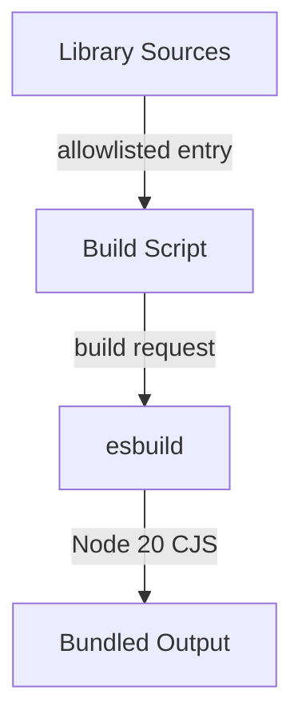

<h3>PR Summary by Qodo</h3>

Bundle dependency-backed library modules with esbuild

<code>✨ Enhancement</code> <code>⚙️ Configuration changes</code> <code>🕐 Less than 10 minutes</code>

AI Description

<dl>
<dd>
 

><pre>
>• Adds an esbuild utility for producing self-contained CommonJS library artifacts.
>• Targets Node.js 20 while externalizing built-in modules.
>• Enables installation without npm dependencies at the target.
></pre>

</dd>
</dl>

Diagram

<dl>
<dd>

 

</dd>
</dl>

High-Level Assessment

<dl>
<dd>

 

>The following are alternative approaches to this PR:

<b>1. Automatic dependency discovery</b>

<dl>
<dd>

- ➕ Avoids manually maintaining the module allowlist
- ➕ Scales as more library modules acquire npm dependencies
- ➖ Requires dependency-graph analysis or broader bundling
- ➖ May unintentionally bundle modules intended to remain source-only

</dd>
</dl>

<b>2. Bundle the complete CLI</b>

<dl>
<dd>

- ➕ Produces one deployable artifact
- ➕ Eliminates per-module bundling decisions
- ➖ Creates a larger artifact
- ➖ Changes module boundaries and may complicate testing or dynamic resolution

</dd>
</dl>

>**Recommendation:** The explicit allowlist is appropriate while only a small, controlled set of modules requires bundling. Before relying on it for releases, expose the script through package.json, invoke it during prepublish, and confirm the installer selects dist artifacts; otherwise the new utility remains a manual build step.

</dd>
</dl>

 Files changed (1) <code> +49 / -0 </code> 

<dl>
<dd>

 

Other (1) <code> +49 / -0 </code>

<dl>
<dd>

build-lib.js<code>Add esbuild pipeline for dependency-backed library modules</code> <code>+49/-0</code>

 

>Add esbuild pipeline for dependency-backed library modules
>
><pre>
>• Introduces an executable build utility that bundles allowlisted library modules into redpill/bin/lib/dist as Node.js 20 CommonJS files. It externalizes selected Node.js built-ins, creates the output directory, reports successful builds, and exits nonzero on failure.
></pre>
>
><a href='https://github.com/jinrunsen/redpill/pull/1/files#diff-a05517244411e5e0f9925072128e63cb802ece3a279739e667ec1b8cd482fed0'>scripts/build-lib.js</a>

</dd>
</dl>

</dd>
</dl>

